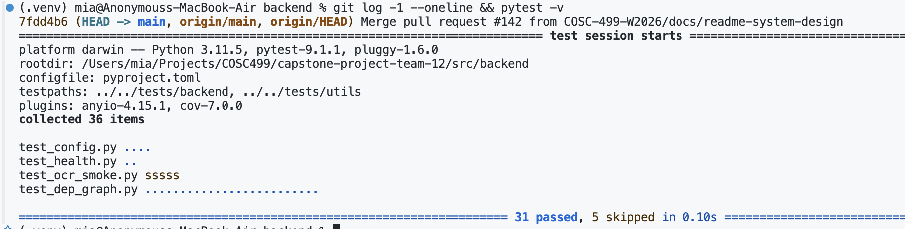
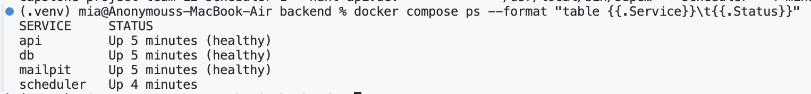
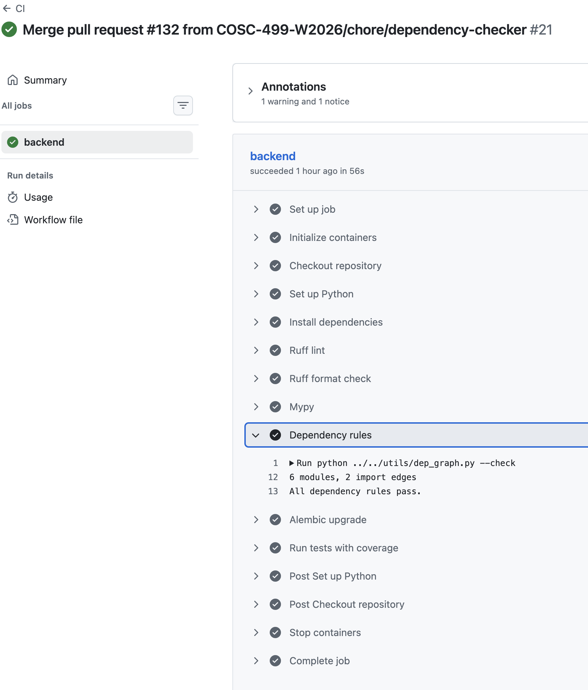

# Week 4 Individual Log
## Mia Kuang

Week 4 (Sep 28 – Oct 4)

**Last week (Sep 21 – 27), project proposal.** I wrote the first draft of our Technical Specification and used it for most of the proposal, then my teammates filled in the rest of the backend and frontend parts. I also helped split the FRs between the four of us. We split them by how much work each one is (OCR plus its evaluation counts as a big chunk), not just by count, and picked two reviewers per PR based on which components depend on each other. All docs, so no PRs for that week.

**This week** I set up the backend skeleton (issue #6) and the component packages with dependency rules (issue #131). My first skeleton PR had 24 files, way over the 10-file limit, so I split it into small stacked PRs and merged them one by one. All 10 are merged now.

| PR | What | Files | Lines | Tests | Status |
|---|---|---|---|---|---|
| #122 | Repo structure | 7 | +17 / -2 | – | merged |
| #123 | Python tooling | 6 | +138 | – | merged |
| #124 | App factory + `/health` | 8 | +51 / -4 | 2 | merged |
| #125 | Settings, DB session, Alembic | 7 | +192 | 4 | merged |
| #126 | Docker Compose | 7 | +151 / -1 | – | merged |
| #130 | Move logs to `logs/` | 7 | +1 / -1 | – | merged |
| #132 | Dependency rule checker | 5 | +296 / -5 | 13 | merged |
| #133 | Dependency graph | 4 | +116 / -2 | 3 | merged |
| #134 | Component packages (part 1) | 8 | +58 / -2 | – | merged |
| #135 | Component packages (part 2) | 9 | +72 / -9 | 2 | merged |

One thing went wrong: Fabiha's CI PR (#128) was stacked on my skeleton PRs and got merged into `main` before #123 to #126, so my code reached `main` through #128 first and #124 showed a README conflict. I merged `main` back into my branch (no code changed) and then merged #124, #125 and #126 in order. CI passed after each merge. Lesson: only retarget a stacked PR to `main` after the PRs under it are merged.

## PR #124: App factory and health endpoint

**Requirement:** the spec (Deployment & Operations) says Docker, CI and the uptime monitor all check `GET /health`, so it needs to return `200 {"status": "ok"}` when the API is up. The team also needs one place to add each component's router.

**What I did:**
- `create_app()` builds the FastAPI app and includes the router
- `GET /health` returns `{"status": "ok"}` without touching the DB, so a slow DB doesn't make the API look down
- `api_router` (prefix `/api/v1`) is where each component adds its routes

**Review:** I ran it with `uvicorn --reload` and in Docker (container shows healthy). Kaedyn found a `StarletteDeprecationWarning` on every test run, so I switched `httpx` to `httpx2` (cb6e769) and checked with `pytest -W error`.

No workaround, functions are tiny (`create_app` 10 lines, `health` 2), no branches. `ruff` and `mypy --strict` are clean, and I went through the code-smell list with nothing to fix. Code is in `app/main.py` and `app/api/v1/__init__.py`. In the DFD it's the entry point of process 0, and processes 1.0 to 5.0 plug their routers into `api_router`.

**Tests** (`tests/backend/test_health.py`): `test_health_returns_ok` (happy path) and `test_unknown_route_returns_404` (negative case, gets 404 not 200/500). Both are integration tests through the test client. No unit tests needed since `health` just returns a constant. Full suite passes. 

## PR #125: Settings, DB session and Alembic

**Requirement:** the spec uses PostgreSQL 16, SQLAlchemy 2.0 and Alembic, with settings from env variables and migrations run before the API starts.

**What I did:**
- `Settings` reads `DATABASE_URL`, `SECRET_KEY`, SMTP settings, etc. from env or `.env`, and `get_settings()` caches it
- `engine`, `SessionLocal`, `Base` and `get_db()` give one session per request
- Alembic uses the same URL and `Base.metadata`

**Data modeling:** `smtp_port` is validated as an int, so a bad value fails at startup instead of when an email is sent. `secret_key` and `database_url` only come from env or a git-ignored `.env`, and `.env.example` has placeholders only.

**Review:** When I reviewed the generated Alembic setup, `alembic upgrade head` failed with `No module named 'app'`, so I added `prepend_sys_path = .` to `alembic.ini` and tested it locally and in the container. The generated `config.py` also hardcoded the default DB URL and a `"change-me"` secret, so I kept them only as local-dev defaults that every real environment overrides.

No workaround, it's the standard SQLAlchemy/Alembic setup. All functions are under 10 lines. Code is in `app/config.py`, `app/db.py` and `alembic/`. In the DFDs this is how every process reads and writes the data stores (D1 to D7), not a process itself.

**Tests** (`tests/backend/test_config.py`): 4 unit tests, covering defaults, env override, caching, and an invalid `SMTP_PORT` that raises `ValidationError` (negative case). DB integration tests come with the schema PR (#8). `docker compose up --build` starts everything with the API healthy.  

## PR #132: Dependency rule checker

**Requirement:** the spec (Backend Architecture) says each component is its own package and others can only use it through `interface.py`. We need CI to fail if someone breaks that.

**What I did:** `utils/dep_graph.py` reads every module's imports with `ast`, puts each module in a group (5 components, shared core, entry layer) and checks 5 rules: only import other components through `interface.py`, no cycles, core can't import components or entry, components can't import entry, every module needs a group. `--check` exits 1 on a violation, and CI runs it on every PR.

**Review:** When I reviewed the generated checker, it left `app.cli` out of every group, so rule 5 flagged it. I added it to the entry layer (16b28cd) with a test. Some generated lines were also over 100 characters (E501), so I reformatted them. Component names are hardcoded, but they're in one list at the top so there's only one place to change.

No workaround. The longest function is `find_cycles` (21 lines), the rest are 5 to 15. It lives in `utils/` because it's a dev tool, not app code. It isn't a DFD process. It makes sure the code follows the Level 1 split.

**Tests** (`tests/utils/test_dep_graph.py`): one negative test per rule, plus tricky imports (relative, submodule, imported names) and `--check` returning 1. These are unit tests on a fake app in `tmp_path`. `test_real_backend_follows_the_rules` is an integration test on the real `app/`. All pass, CI passes. 

## PR #133: Dependency graph

**Requirement:** we need to show the repo structure, and the team needs to see how components depend on each other.

**What I did:** `--graph` writes a Mermaid diagram to `docs/architecture/dependency-graph.md`, grouped by component, which GitHub renders directly. I added the command to the README.

**Review:** I checked the graph against the real imports by hand and they matched. It's generated from the code so it can't go out of date. Small functions (`mermaid` 18 lines, `report` 20), and it reuses the checker's parser so there's no duplicate code. Not a DFD process.

**Tests:** 3 unit tests. `test_graph_flag_writes_the_file` uses `monkeypatch` so it writes to `tmp_path` and not the real docs folder. All pass.

## PR #134 and #135: Component packages

**Requirement:** the spec says one package per component, matching the DFDs, and each owner needs a place for their code with an `interface.py`.

**What I did:** split into two PRs to stay small.
- #134: `app/accounts` (1.0, Kaedyn), `app/game` (2.0, me), `app/verification` (3.0, Eddy)
- #135: `app/engagement` (4.0, Fabiha), `app/content` (5.0, Eddy), and added `models` and `services` to the shared core

Each package has a docstring with what it does and who owns it, plus an empty `interface.py`. I updated the backend README and regenerated the graph.

**Review:** When I reviewed the generated docstrings, they put TA invitations under engagement and audio reports under game, which didn't match the board, so I moved them to accounts and content and updated the DFDs. No logic in these PRs, and owners add their interface functions later. They map to DFD processes 1.0 to 5.0.

**Tests:** #134 is covered by the existing real-backend check. #135 adds `test_components_share_models_and_services` and `test_rule3_models_must_not_import_a_component`. All 31 tests pass.

## Setup PRs without tests (#122, #123, #126, #130)

- **#122:** split `src/` and `tests/` into `backend/`, `frontend/` and `e2e/`, as the course asks.
- **#123:** `pyproject.toml`, pinned requirements, `ruff.toml` and setup steps. When I reviewed the generated setup, it used `uv` and a `uv.lock`, which the team hadn't used, so I switched to plain venv + pip. It also installed `uvloop` on every platform, which breaks on Windows, so I added a platform marker, and added Windows venv steps after Eddy's review.
- **#126:** Dockerfile and `docker-compose.yml` for api, db, scheduler and mail. The scheduler container is the Scheduler entity in the DFDs, and it builds on both Apple Silicon and Intel. Tested with `docker compose up --build`. 
- **#130:** moved `docs/logs/` to `logs/` with `git mv` to match the rubric path.

## Other work this week

- **Team PRs:** #142 adds a System Design section to the README with links to the architecture diagram, the Level 0 DFD and each component's Level 1 DFD, plus a short explanation of each component. #144 adds our week 4 team log to `logs/team/week-4.md`.
- **Reviews:** #127 API conventions (3 rounds; on the last one I pushed a commit to save Kaedyn another round: 422 for all validation errors, `Retry-After` for `OCR_BUSY`, and some markdown fixes) and #128 CI (2 rounds, plus a commit so CI lints `tests/` and `utils/`).
- **Design docs:** updated the Level 1 DFDs to match the board, added a few missing error cases to the Auth DFD, added a shared-core box to the architecture diagram and redrew the ER diagram in draw.io. In the spec I added the code layout, fixed the data model (case-insensitive email and username, one owner per class, no hard deletes) and removed an old architecture picture.
- **Planning:** wrote the plan for the core schema (#8). It's two PRs, and columns pointing to other components' tables get added later by their owners.
