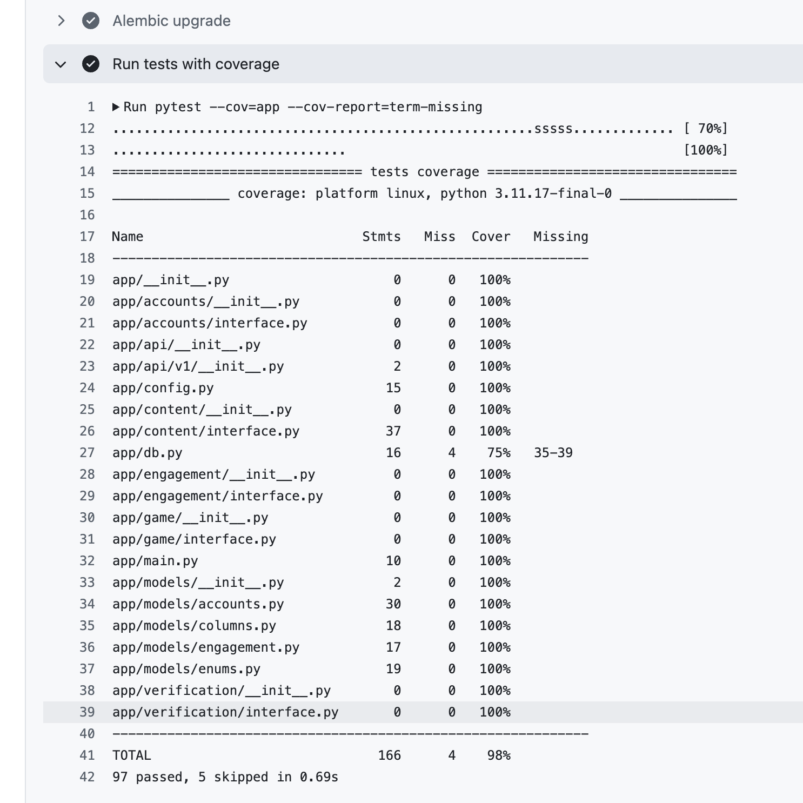
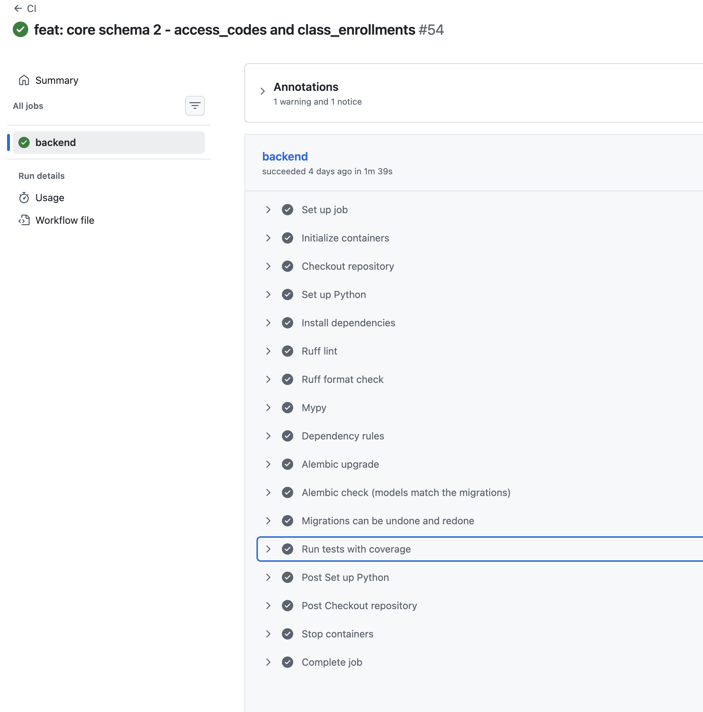
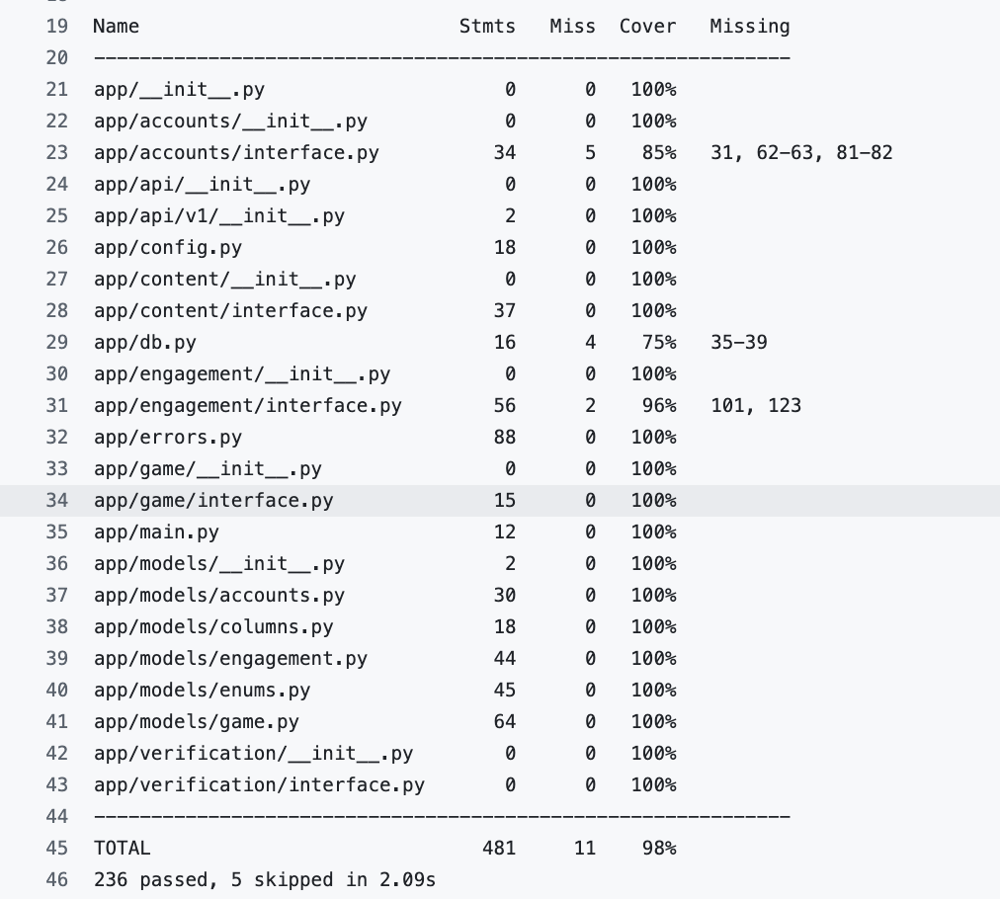
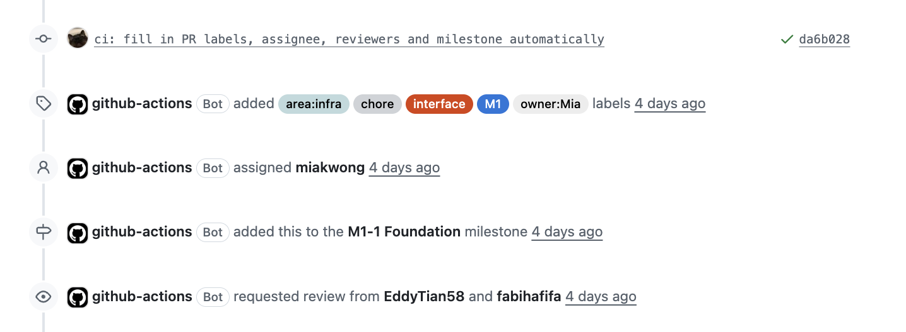

# Week 5 Individual Log

## Mia Kuang

Week 5 (Oct 5 – Oct 11)

**This week** I worked on the core schema (issue #8) and the first part of the game schema for A7 (issue #39). I split the core schema into two stacked PRs: PR 1 is stacked on Eddy's #149 because it reuses the `Language` enum from it, and PR 2 is stacked on PR 1. PR 1 first had 10 files, so I moved the Alembic and CI changes into PR 2 to keep it smaller. I also added shared test fixtures and error codes that everyone's interface PRs needed, a workflow that fills in PR labels and reviewers, and moved the weekly logs off `main`.

| PR | What | Files | Lines | Tests | Status |
|---|---|---|---|---|---|
| #150 | Core schema 1 | 8 | +494 / -3 | 19 | merged |
| #151 | Core schema 2 | 6 | +482 / -8 | 29 | merged |
| #153 | PR metadata workflow | 2 | +173 | – | merged |
| #154 | `game_sessions` table | 8 | +428 / -5 | 21 | merged |
| #157 | Shared test fixtures | 3 | +382 / -172 | 6 | merged |
| #158 | Shared error codes | 5 | +314 / -4 | 19 | merged |
| #159 | Move Kaedyn's week 4 log | 1 | +33 / -1 | – | merged |
| #160 | Remove logs from main | 8 | +27 / -103 | – | merged |
| #161 | `session_locations` table | 6 | +459 / -7 | 29 | merged |
| #165 | End open games (wrong base) | 2 | +151 / -2 | 4 | merged into the wrong branch (see below) |
| #170 | End open games | 2 | +151 / -2 | 4 | merged |

One thing went wrong: #165 was stacked on #161. After #161 was squash-merged into `main`, I merged #165 without switching its base first, so it went into `feat/session-locations` instead of `main`, and `end_open_sessions` never reached `main`. I left #165 as it is with a note, rebased the same three commits onto `main` and opened #170, which is now merged into `main`. Lesson (again, after week 4): switch a stacked PR's base to `main` and rebase it before merging. Squash-merging the base of a stack also forces the next PR to be rebased, so for stacked PRs a normal merge commit is easier.

## PR #150: Core schema 1 (users, classes, class_staff)

**Requirement:** issue #8 and the spec's Data Models and Key Constraints sections. Every developer on the team needs the `users`, `classes` and `class_staff` tables before they can add their own tables and write their services. The DB design doc also says #8 PR 1 sets the naming convention for every constraint.

**What I did:**
- `app/db.py` puts a naming convention on `Base.metadata`, so every constraint has a fixed name (`uq_users_email`, `ck_users_role`, ...), and maps `str` / `datetime` to `text` / `timestamptz` (developers writing models and migrations)
- `app/models/columns.py` has shared helpers for the UUID primary key, timestamps and `CHECK (col IN (...))`, including one language CHECK, so adding a language only changes the `Language` enum (developers writing models)
- `users`: lowercase email (unique plus a CHECK), case-insensitive username through a unique index on `lower(username)`, username length 3 to 30 with no spaces around it, role and Practice language CHECKs, and only staff accounts can have content rights (Accounts, all components that look up a user)
- `classes`: `UNIQUE (id, target_language)` for the composite FK in PR 2, a language CHECK, and the semester as a UBC term code like `2026W1` (Engagement, Game)
- `class_staff`: primary key `(class_id, user_id)` and a partial unique index, so a class has at most one owner but any number of TAs, with the index condition built from the enum (Engagement, Accounts)

**Data modeling:** `password_hash` is nullable because a staff account created by an admin has no password until the set-password link is used. This wasn't clear in the spec, so I added it. `semester` has a CHECK for the UBC term code, so something like "Fall 2026" is rejected by the database (I added the format to the spec too). The TA same-language rule spans two tables, so it stays in the service layer (decided in the DB design doc).

**Review:** I checked the autogenerated migration line by line against the spec and found no problems (this time it picked up the CHECKs and the partial and expression indexes), so I only removed the template comments. The first test helper needed a `type: ignore`, so I typed the role as `str` and removed it. Creating my branch from Eddy's branch also tracked his branch as upstream, so a plain `git push` would have pushed to his PR, so I unset the upstream before pushing. Eddy's (EddyTian58) review led to three changes: the owner index condition is built from the enum, a raw SQL `INSERT ... RETURNING` tests the database defaults, and two new CHECKs (no spaces around a username, content rights only for staff accounts).

No workaround, the tables follow the spec and the DB design doc, and later PRs add their columns through new migrations instead of changing these. Functions and classes are small (`User` 32 lines, `ClassStaff` 23, `Class` 18, `get_db` 7, every helper in `columns.py` 7 lines or less). `ruff check` and `mypy --strict` are clean, and I went through the code-smell list with nothing to fix: role, language and status values all come from the enums, so each value is written in one place only, and the shared helpers stop each model from repeating the same CHECK code. Code is in `app/db.py`, `app/models/columns.py` and the model files under `app/models/`, because all ORM models live in the shared core so every component can use them through foreign keys. In the DFD it's data stores D1 (users) and D3 (classes and class staff), used by processes 1.0 (Auth) and 4.0 (Class Engagement).

**Tests** (`tests/backend/test_core_schema.py`): happy paths are a valid user, class and owner, two TAs in one class, and server defaults through raw SQL. Negative cases: uppercase or duplicate email, a username that's too short, too long or has spaces around it, an unknown role or language, a bad semester, a second owner, and content rights on a student. Each one checks the constraint name in the error, so it can't pass because a different constraint failed. All 19 are integration tests against real Postgres. No unit tests because the models have no logic of their own, the rules are in the database. Full suite passes, and the migration upgrades, downgrades and upgrades again cleanly. 

## PR #151: Core schema 2 (access_codes, class_enrollments)

**Requirement:** issue #8 and the spec. Fabiha and anyone building joining a class (A5), access codes (A6) and removing or restoring students (A17) need the `access_codes` and `class_enrollments` tables, with the rules about who can be in which class enforced by the database.

**What I did:**
- `access_codes`: a unique code stored as 8 characters without the hyphen (shown as `K7PM-3QXD`), from an alphabet with no 0/O or 1/I/L. `max_uses` is null or above 0, and `uses_count <= max_uses` so two students using the last slot at once can't go over the limit (Engagement)
- `class_enrollments`: a composite FK `(class_id, language)` to `classes (id, target_language)`, one row per student and class (reused on rejoin), a partial unique index for one active class per language, CHECKs that someone still in the class has no end reason and no leave time, a composite FK so the code used belongs to the class, and a leave time that can't be before the join time (Engagement, Game)
- `EnrollmentEndReason`: `left` (can rejoin with a code), `removed` (by the owner, can't rejoin with a code but can be restored) and `archived` (Engagement)
- `alembic/env.py` imports every model, and CI now runs `alembic check` and a downgrade/upgrade round trip (moved here from #150) (developers, CI)

**Data modeling:** `code` has CHECKs for 8 characters from the allowed alphabet with no hyphen. Storing it without the hyphen keeps the lookup simple, so I added that to the spec. `uses_count` has a CHECK so it never goes over `max_uses`, even if two students join at the same moment. The rejoin rules and the TA same-language rule stay in the service layer.

**Review:** The migration had no problems line by line (composite FK, partial index on `is_active`, CHECKs). In the tests, the unknown-end-reason test matched the start of another constraint's name, so it could pass for the wrong reason, and the test helper made codes with 0 and 1, so I matched the full constraint name and fixed the helper. Eddy's (EddyTian58) review led to a composite FK for the class of the code, CHECKs that tie the leave time and end reason to the status, and a test for rejoining the same class.

No workaround, the constraints come from the spec, and CI now checks that the models and migrations never drift apart. Classes are small (`AccessCode` 28 lines, `ClassEnrollment` 37, mostly column and constraint definitions). `ruff` and `mypy --strict` are clean, and I went through the code-smell list with nothing to fix. The code alphabet and the end reasons come from one place each. Code is in the model files under `app/models/` and `alembic/env.py`, for the same reason as #150. In the DFD it's data store D3, used by processes 4.2 (access codes), 4.3 (archive, remove or restore) and 4.4 (join or leave).

**Tests** (`tests/backend/test_core_schema.py`): happy paths are a valid code, `max_uses = 1`, joining a class, a second active class in another language, joining another class or the same class again after leaving, and server defaults through raw SQL. Negative cases: duplicate code, a code with a hyphen, lowercase, too short or too long, confusing characters, `max_uses = 0`, going over `max_uses`, negative `uses_count`, a language that doesn't match the class, a second active class in the same language, an end reason or leave time that doesn't match the status, leaving before joining, and an unknown end reason, each failing with the right constraint name. All 29 are integration tests against real Postgres. All 48 schema tests pass, and the new CI steps (`alembic check` and the downgrade/upgrade round trip) passed on the PR. 

## PR #154: Game schema 1 (game_sessions)

**Requirement:** A7 (start a game) and issue #8. Eddy and I write the game and verification services, and we need a table for a game before any service or route for it can be written. I opened it as a draft first so the team could check the columns.

**What I did:**
- `game_sessions` has `SessionState` (`active`, `paused`, `completed`, `abandoned`) and `SessionEndReason` (`quit`, `reset`, `expired`, `class_closed`) (Game)
- a partial unique index makes sure a student has at most one open (active or paused) game (Game)
- a composite FK `(class_id, target_language)` to `classes` makes a class game use the class language. Practice games have no class, so the FK is skipped (Game, Engagement)
- CHECKs: difficulty 1 to 3, end reason only on abandoned games, `paused_at` only while paused, `completed_at` only when completed, and no negative counters (Game)
- a partial index on `last_activity_at` for open games, for the job that expires games after 24 hours (scheduler)

**Data modeling:** `difficulty` has a CHECK for 1, 2 or 3, built from the enum. The upper limits (5 locations, 2 shuffles) are in `Settings`, because the spec lists them as configuration. The database only checks the lower bounds, so changing a setting can't make the service allow a move the database rejects.

**Review:** The generated migration's difficulty CHECK compared the integer column with strings (`IN ('1', '2', '3')`), so I changed it to integers built from the enum. The first version had `game_sessions` and `session_locations` together at about 640 lines, so I split them into two PRs (#154 and #161). Eddy's (EddyTian58) review led to moving the upper limits to `Settings`, an index on `class_id`, and the missing tests.

No workaround, the limits live in `Settings` and the states come straight from the spec's Session Lifecycle. `GameSession` is 69 lines, almost all column and constraint definitions, with no methods. `ruff` and `mypy --strict` are clean, and I went through the code-smell list with nothing to fix. The state and end reason values come from the enums, and the limits come from `Settings`. Code is in `app/models/game.py`, because all ORM models live in the shared core. In the DFD it's data store D5 (Game Sessions), used by process 2.0 (Game Session).

**Tests** (`tests/backend/test_game_schema.py`): happy paths are a new game after the old one was abandoned or completed, Practice in any language, and server defaults through raw SQL. Negative cases: a second open game (active or paused), a class game in the wrong language, difficulty 0 and 4, an end reason and timestamps not matching the state in both directions, an abandoned game that still has `paused_at`, an unknown state, end reason or language, and counters below zero, each failing with the right constraint name. All 21 are integration tests against real Postgres. Full suite passes after the rebase onto `main`.

## PR #161: Game schema 2 (session_locations)

**Requirement:** A7 (#39) and #8. A student playing a game, and the game and verification services, need each game to have 5 locations, and each location needs to keep a snapshot of its content from when it was drawn, so editing a location in the middle of a game doesn't change that game.

**What I did:**
- `session_locations` has the location status, skip reason and GPS override enums, one row per position and per location in a game, and range CHECKs on the GPS fields, attempts, points and radius (Game, Verification)
- like #154, only the lower bounds are in the database. The photo attempt limit is a new setting (Game)
- a completed location has its 100 points and `completed_at`, and failed or skipped ones have neither. Both snapshots must be non-empty JSON arrays (Game)
- `flags` uses `MutableList`, so `flags.append(...)` is actually saved (Verification)
- a shared `make_session_location` fixture is ready for the verification tests later (developers)

**Data modeling:** `points` and `completed_at` have CHECKs so they match the status, and a skipped location can't have 100 points. The answers and the clue snapshot have CHECKs so they're non-empty JSON arrays, and no location is created that nobody can complete.

**Review:** My first draft hardcoded the upper limits again, the same issue Eddy found in #154, so I moved them to `Settings` like before. One generated test put two failing inserts together, so the second one failed for the wrong reason after the first rolled the savepoint back, so I split it into a parametrized test. Eddy's (EddyTian58) review led to `MutableList` for `flags`, a CHECK that ties points to the status, a non-empty check on the answer list, and two fixed tests. The PR then went over our ~500 line limit, so I split `end_open_sessions` into #165.

No workaround, the snapshot design comes from the spec and the limits are in `Settings`. Functions and classes are small (`non_empty_array` 5 lines, `SessionLocation` 83 lines of column and constraint definitions with no methods). `ruff` and `mypy --strict` are clean, and I went through the code-smell list with nothing to fix. `non_empty_array` builds the same CHECK for both snapshots, so it isn't repeated. Code is in `app/models/game.py` next to `game_sessions`, because the two tables belong together. In the DFD it's data store D5 (Game Sessions), used by processes 2.0 (Game Session) and 3.0 (Photo Verification).

**Tests** (`tests/backend/test_game_schema.py`): happy paths are a valid location in each status, an appended flag being saved, and server defaults through raw SQL. Negative cases: a duplicate position or location, a skip reason that doesn't match the status, points and `completed_at` that don't match the status, empty or non-array snapshots, every range CHECK and unknown values, each failing with the right constraint name. All 29 are integration tests against real Postgres (50 tests in the file together with `game_sessions`). Full suite passes.

## PR #165 and #170: End open games when a class closes

**Requirement:** the spec's Session Lifecycle section. A student whose class is archived, or who leaves or is removed from a class, needs their open games to end. This came from my #155 review: Fabiha's first version put this in engagement, which would call into game while game already calls engagement, so `dep_graph.py --check` would reject the cycle. The spec says the route calls both components in turn instead.

**What I did:** `end_open_sessions(class_id, db, student_id=None)` in game's interface ends a class's open games, or one student's when `student_id` is given (for Fabiha's archive, leave and remove routes):

- open games become `abandoned` (`class_closed`) and `paused_at` is cleared
- unfinished locations are skipped, and points stay
- it returns how many games ended
- it doesn't commit, so the route runs it in the same transaction as Fabiha's part

**Review:** Eddy's (EddyTian58) review led to leaving `last_activity_at` unchanged instead of setting it to `now()`.

No workaround, ending games through game's interface is the design in the spec, and it keeps the dependency direction the checker enforces. `end_open_sessions` is 28 lines, including its docstring. `ruff` and `mypy --strict` are clean, and I went through the code-smell list with nothing to fix. It uses two bulk UPDATEs, so it doesn't load every game into Python. Code is in `app/game/interface.py`, because it's the only file other components can import from game. In the DFD it's process 2.0 (Game Session) in the Level 1 diagram, on the flow from 4.3 (archive, remove or restore) and 4.4 (join or leave) that ends a student's games.

**Tests** (`tests/backend/test_game_interface.py`): happy paths are only that class's games end, and `student_id` limits it to one student. Edge cases where games or locations must be left alone: a game in another class keeps its locations, finished games don't change, and completed and failed locations and `last_activity_at` stay as they are. I checked these fail when I put the bugs back (a wrong filter, and setting `last_activity_at`). All 4 are integration tests because they run the function against real Postgres. Full suite passes and CI is green on #170. 

## PR #157: Shared test fixtures

**Requirement:** follow-up to #7, which asked for shared `client`, `db` and `make_user` fixtures. Every developer writing tests needs to make users, classes and enrolments in their tests and call endpoints against the test database. #128 left `make_user` out because there was no `User` model yet, and `client` had a TODO to use the test database. The spec says every endpoint and business rule is tested against real Postgres.

**What I did:**
- five factory fixtures in `conftest.py` (`make_user`, `make_class`, `make_class_staff`, `make_access_code` and `make_enrollment`) each make a valid row with unique values, and any column can be overridden (developers writing tests)
- `client` uses the test session, so endpoints see rows a test made, and everything is rolled back even if the endpoint commits (developers testing endpoints)
- `test_core_schema.py` uses the fixtures instead of its own helpers (same 48 tests)

**Review:** The first version of the shared helper used the `def _add[T]` syntax from Python 3.12, but we target 3.11, so I rewrote it with a normal `TypeVar`.

No workaround, it removes the TODO in `client` instead of adding one. Every fixture is 17 lines or less. Code is in `tests/backend/conftest.py`, because pytest shares fixtures from there with every test file. It isn't a DFD process, it's test code.

**Tests** (`tests/backend/test_factories.py`): the factories make valid rows (happy path), and they don't make extra rows when given a code or a creator. All 6 are integration tests because they use the real test database, and one checks that the client sees rows made in the test. The 48 schema tests still pass after switching to the fixtures.

## PR #158: Shared error codes and handlers

**Requirement:** follow-up to #9, which asked for the conventions page (#127) and a shared error helper with exception handlers. A developer writing a service, interface or route, and the frontend reading errors, need one way to say which error a failure is, and get every error back in the same format. Only the page was merged last week, and the interface PRs (#152, #155, #156) needed the codes.

**What I did:**
- `app/errors.py` has `ErrorCode` with all 32 codes from the spec plus 5 generic ones (`VALIDATION_ERROR`, `NOT_AUTHENTICATED`, `NOT_FOUND`, `METHOD_NOT_ALLOWED`, `INTERNAL_ERROR`), the HTTP status of each code, and `AppError` for services and interfaces to raise (developers)
- handlers make every error use the `{"error": {...}}` format: `AppError`, validation errors (422 with the invalid fields), unknown routes and methods, plain `HTTPException`s, and unexpected errors (500, logged but never shown to the client) (frontend, developers)
- `errors` is added to the shared modules in `dep_graph.py`, and the conventions doc has a short section on how to raise errors (developers)

**Data modeling:** an unexpected error (the exception message, SQL, any password) could leak to the client, so the handler logs it and only returns `INTERNAL_ERROR` with no details.

**Review:** `mypy` showed the handler passed FastAPI's header `Mapping` where `AppError` expects a `dict`, so I converted it.

No workaround, the codes come from the spec and the format from the conventions page. Functions are small (`AppError.__init__` 12 lines, `add_error_handlers` 6, each handler a few lines). `ruff` and `mypy --strict` are clean, and I went through the code-smell list with nothing to fix. Every handler builds its response through one `_response` helper, and each status is written once next to its code. Code is in `app/errors.py`, because errors are shared by every component, like `config` and `db`. In the DFD it's process 0 in the Level 0 diagram, because every request goes through it. It isn't a data flow in the Level 1 diagrams.

**Tests** (`tests/backend/test_errors.py`): happy paths are every code has a status, statuses match the spec, the standard body, and `Retry-After` passed through. Negative cases: validation errors, unknown routes (404) and methods (405), a plain `HTTPException(403)`, and a crash whose fake password and SQL must not appear in the response. Each returns the right status and code, and the crash returns 500 with no details. All 19 are integration tests because they send requests through the real app with test-only routes. Full suite, `mypy` and the dependency check still pass.

## Setup PRs without tests (#153, #159, #160)

- **#153:** PR metadata workflow. Labels, assignees and milestones kept being forgotten, and picking reviewers by hand from the review cycle in our contract was easy to get wrong. `.github/workflows/pr-metadata.yml` runs on every PR and adds the type label from the title prefix (`feat:` → `feature`), `test` if `tests/` changed, the area, owner, interface and M1 labels and the milestone from the issue in `Closes #N` or `Part of #N`, the author as assignee, and reviewers from the review cycle. If a second teammate is added as an assignee (a PR written together), the other two teammates review instead, as the contract says. I also added `.github/pull_request_template.md` with the sections we already use, including "AI-generated code I fixed in review". When I reviewed the first run on #153 itself, it copied labels from #8 even though the PR has no issue, because an example in the description said `Part of #8`, so it now ignores code, code blocks and HTML comments before looking for issue numbers. No unit tests (it's a workflow), but I ran the script against fake PR data for one author, two authors, a draft, an edit and the #150 case, and it gave the same labels I had set by hand. The real run on #153 added the labels, assignee, milestone and reviewers. 
- **#159:** moves Kaedyn's week 4 log to `weekly-logs` with a merge commit, so weekly logs live only on `weekly-logs`.
- **#160:** removes `logs/` from `main`, rewrites the README folder tree to match the repo, and adds a rule to CONTRIBUTING that `weekly-logs` is never merged into `main`. No code logic in #159 or #160, so no tests.

## Other work this week

- **Reviews:** #149 (Eddy's content eligibility stub, approved). #155 (Fabiha's class and enrolment lookup): requested changes because the class-closed notice would create a dependency cycle, then re-reviewed the real queries and found a test that breaks a CHECK on `class_enrollments`, which is why CI was red. #156 and #152: comments on how to test the stubs and on using the error codes from #158.
- **TA rule change:** from professor feedback, a TA can't be a student in the same class, but other classes in the same language are fine. I renamed the error code to `TA_SAME_CLASS_CONFLICT` in #158 and updated the spec, the proposal (A5, A26, Table 4), the DB design doc, two DFDs and issues #10, #75 and #85.
- **Audio design fix:** the spec said the audio service returns a clue's primary recording during play, which breaks the snapshot rule (a new recording would change a game in progress). Now the recording is chosen when the location is drawn, and game only asks for a URL by the snapshot's `audio_asset_id`. I updated the spec, proposal Table 4 and issues #13, #77 and #94, and left a note for Eddy on #13.
- **Proposal feedback:** privacy export and delete moved from the CLI to the admin panel with safeguards. I updated the spec, the proposal (A21, A27, B21), the architecture diagram, the Level 0 DFD, the Auth DFD and the ER diagram.
- **DB design doc:** for #8, I answered Eddy's comments and finalised the conventions (enum CHECKs, UUIDs, interface functions never commit). I reopened #8 with a progress comment, since `game_sessions` and `session_locations` were still open at the time. Both are now merged (#154, #161).
- **Planning:** split the M1-1 account work with Kaedyn. He does sign-up and sign-in first, then A4 (role-based access) because everyone's routes depend on it. I offered to take A3 (email verification and password reset) and start a draft PR for it.
- **Note for Fabiha:** for A5, the CHECK can't stop lost updates on `uses_count`, so the join service should increment it in SQL. I put this in #151.
