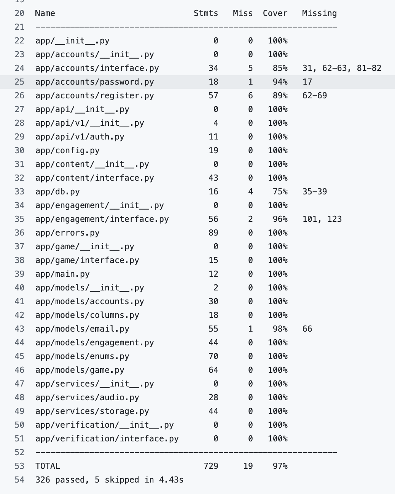
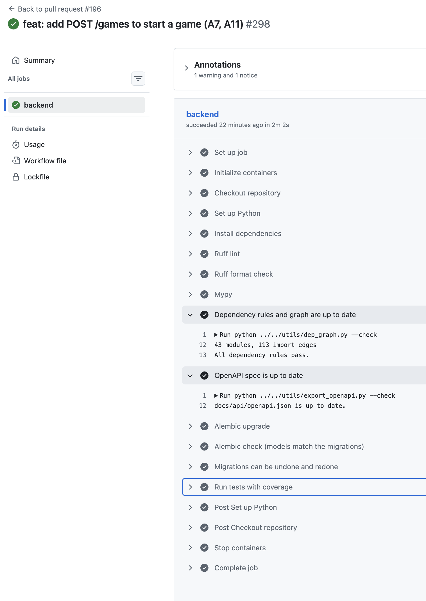
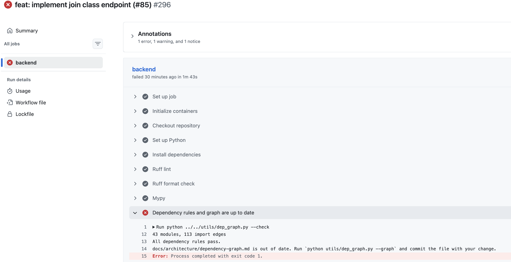

# Week 6 Individual Log

## Mia Kuang

Week 6 (Oct 12 – Oct 18)

**This week** I worked on A3 (email verification and password reset, issue #70), a CI check for the OpenAPI document, and the first four PRs of A7 and A11 (starting a game). A3 was originally Kaedyn's part of the M1-1 account work, but it was moving slowly, so I took it over. I split it into six stacked PRs so each one stayed close to the 500-line limit: #175, #176, #183, #184, #185 and #186. #179 is separate: a CI step that fails when `docs/api/openapi.json` doesn't match the code. For A7 and A11 I opened #187 (draw a game's locations), #194 (`abandon_sessions`), #188 (the `start_game` service) and #196 (the `POST /games` route). All of them are merged. On Oct 18 I also opened #209, a CI check that fails when `docs/architecture/dependency-graph.md` is out of date. It was merged the same day.

| PR | What | Files | Lines | Tests | Status |
|---|---|---|---|---|---|
| #175 | Email schema | 5 | +498 / -2 | 9 | Merged Oct 15 |
| #176 | `EmailService` | 3 | +473 / -1 | 15 | Merged Oct 15 |
| #179 | OpenAPI CI check | 10 | +496 / -4 | 10 | Merged Oct 16 |
| #183 | Send-emails job | 5 | +493 / -5 | 15 | Merged Oct 16 |
| #184 | SMTP delivery | 9 | +480 / -15 | 10 | Merged Oct 16 |
| #185 | Verify, resend, forgot-password | 8 | +613 / -3 | 11 | Merged Oct 17 |
| #186 | Reset password | 6 | +291 / -6 | 14 | Merged Oct 17 |
| #187 | Draw locations | 7 | +487 / -1 | 22 | Merged Oct 17 |
| #194 | `abandon_sessions` | 5 | +243 / -23 | 13 | Merged Oct 17 |
| #188 | `start_game` service | 5 | +492 / -0 | 23 | Merged Oct 17 |
| #196 | `POST /games` route | 6 | +499 / -1 | 16 | Merged Oct 18 |
| #209 | Dependency graph CI check | 5 | +204 / -8 | 5 | Merged Oct 18 |

Lines are GitHub's numbers. They include the generated `docs/api/openapi.json` (+283 in #179, +177 in #185, +73 in #186 and +191 in #196), so #185 is over 500 only because of it (+436 / -3 without it).

**One thing went wrong:** my first version of the send-emails job (#183) deadlocked. When the mailer hit its quota, the job paused the queue while the failed row was still locked, so the next run waited on it. `pytest` on one connection never showed this. I found it by running two real connections by hand (`DeadlockDetected` in 3 of 3 runs), fixed it by rolling back before pausing, and re-ran it with no deadlock. Lesson: for any code that locks rows, test with two real connections before asking for review, not only with the single-session fixtures.

## PR #175: Email schema (email_tokens, email_outbox)

**Requirement:** issue #70 and the spec's Email delivery section. Every developer who sends mail needs a table for single-use links and a table for the mail waiting to be sent before any service or route can use them. A3 was originally Kaedyn's, and I started with the tables when I took it over.

**What I did:**

- `EmailKind` (`verify_email`, `reset_password`, `set_password`, `change_email`, `email_changed_notice`, `ta_invitation`) and `EmailStatus` (`pending`, `sent`, `failed`) are enums in `app/models/enums.py`, and every `CHECK` is built from them (developers writing email code)
- `email_tokens` stores only the SHA-256 hash of a single-use token, `new_email` only for `change_email` (lowercase), and an index on `user_id` (Accounts)
- `email_outbox` stores the mail to send: `params` must be a JSON object that can't hold a token, priority is 1 for password and email-change mail and 2 for verification and TA invitations (a CHECK tied to the template), `sent_at` is set exactly when the status is sent, and attempts stop at 5 (Accounts, send-emails job)
- Indexes: pending mail by priority and age, `(to_email, template, created_at)` for the 3-per-hour limit, and a partial unique index so a user has at most one pending reset mail (Accounts)

**Data modeling:** `token_hash` stores only the hash, so a copy of the database can't be used to reset a password. The `params` `CHECK` only looks at the top level, so `EmailService` has to guarantee the rest, and I left a comment saying so. The condition of the partial index is written as literals, because with bound parameters Postgres stops matching `ON CONFLICT` to the partial index once it switches to a generic plan.

**Review:** One test name mentioned a "failure note" column that the table doesn't have, so I renamed it, and `mypy` flagged missing annotations in the tests, so I added them. Eddy's review found that `priority_for` accepted an unknown kind, so it now raises `ValueError`. I also added an index on `email_outbox.user_id` and rewrote the `EmailKind` docstring. He suggested `next_attempt_at` in the pending index, which I did in #183 where the job first uses it.

No workaround, the tables follow the spec and later PRs change them only through new migrations. Classes and functions are small (`EmailOutbox` 51 lines, `EmailToken` 24, `_priority_matches_template` 9, `priority_for` 7). `ruff` and `mypy --strict` are clean, and I went through the code-smell list with nothing to fix: kinds, statuses and priorities come from one place each. Code is in `app/models/email.py`, `app/models/enums.py` and an Alembic migration, because all ORM models live in the shared core. In the DFD it's the data read and written by process 1.3 (email links) and the send-emails job (1.5) in the Auth DFD.

**Tests** (`tests/backend/test_email_schema.py`): happy paths are each mail kind with its priority, sent and failed rows, and a token with and without `new_email`. Negative cases: a priority that doesn't match the template, `params` that aren't an object or hold a token, a sent row without `sent_at`, more than 5 attempts, a second pending reset for one user, and `new_email` on a token that isn't `change_email`, each failing with the right constraint name. All 9 are integration tests against real Postgres. Full suite passes, and the migration upgrades, downgrades and upgrades again cleanly. 

## PR #176: EmailService (queue mail, create and use links)

**Requirement:** issue #70 and the spec's Email delivery section. Kaedyn's sign-up, my routes and the send-emails job need one place to queue a mail and to create and use the single-use links in it. Stacked on #175.

**What I did:**

- `queue_email(user, kind, db, *, to_email=None, params=None)` adds an outbox row with the priority for its kind and a trimmed, lowercase address (a blank one raises `ValueError`). A second pending reset adds nothing (`ON CONFLICT DO NOTHING` with one retry), and if the address changed it updates the pending row and resets the backoff (Accounts)
- `count_recent` counts mails to a normalised address in the last hour for the 3-per-hour limit (Accounts)
- `create_token` returns the raw token once and stores only its hash. A reset link lasts 60 minutes, a set-password link 3 days, a change-email link 24 hours and a verification link 7 days (`TOKEN_TTL`), and a new link cancels older unused links of the same kind (Accounts)
- `consume_token` marks a link used. A wrong, used or expired token raises `INVALID_TOKEN` (400) without marking anything used. Both functions lock the user row with `FOR NO KEY UPDATE`, so two requests can't both create or use a link (Accounts)
- `invalidate_user_tokens` cancels a user's unused links and raises for a kind that has no link. Nothing in the service commits, because the caller owns the transaction (all callers)

**Review:** The generated `queue_email` returned a 500 on a second reset request because it hit the unique index, so I used `ON CONFLICT DO NOTHING` with one retry and added a test that calls it 15 times on one connection. I also fixed `new_email` not being trimmed, `invalidate_user_tokens` silently doing nothing for a kind without a link, and a blank `to_email` being stored. Several tests counted every row in the table, so they broke on my local dev database (it holds Mailpit mail), and I filtered them by user. With that test-only fix the PR was still under 500 lines (+473 / -1). Eddy's review found that callers had to edit the returned row, so `count_recent` never matched an address like `" New@x.com "`. `queue_email` now takes `to_email` and `params`, and `db` comes after the required arguments (the convention from #169 and #178). I also reset the backoff only when the address changes (`IS DISTINCT FROM`), read the database clock once and moved the lifetimes into `TOKEN_TTL`.

No workaround, the service follows the spec, and I checked the lock by hand with two real connections and found no deadlock. Functions are small (`consume_token` 24 lines, `count_recent` 15, `invalidate_user_tokens` 14, `_new_email_for` 9, `_lock_user` 8), except `queue_email` at 59 lines because it handles the conflict retry and the address update. `ruff` and `mypy --strict` are clean, and I went through the code-smell list with nothing to fix: priorities and lifetimes each live in one place. Code is in `app/services/email.py`, because sign-up, the routes and the job all need it and the routes only call it. In the DFD it's process 1.3 (email links).

**Tests** (`tests/backend/test_email_service.py`): happy paths are queueing each kind, a reset link used once, a new link cancelling the old one, the 3-per-hour count and a changed address on a pending mail. Negative cases: a blank address, a second pending reset, a wrong, used or expired token (not marked used), a kind without a link, and 15 calls on one connection. All 15 are integration tests against real Postgres, with 100% coverage for `services/email.py`. I ran the locking by hand with real connections, because `pytest` uses one session. Full suite passes and CI is green.

## PR #179: CI check for the OpenAPI document

**Requirement:** follow-up to the API conventions (#127), no issue. Every developer and the frontend need `docs/api/openapi.json` to always match the code, so nobody builds against a stale API description.

**What I did:**

- `utils/export_openapi.py` writes `docs/api/openapi.json` the same way every time, and `--check` exits 1 if the committed file is stale (developers, CI)
- `.github/workflows/ci.yml` has a new step "OpenAPI spec is up to date" (CI)
- `app/errors.py` has `ErrorBody`, `ErrorResponse` and `error_responses(*statuses)`, so routes document our error format, and 422 is documented with it too (all routes)
- `registerUser` and `getHealth` get their `operation_id` from the table in `docs/api-conventions.md`, and register lists 409 `EMAIL_TAKEN` and `USERNAME_TAKEN` (frontend)
- `CONTRIBUTING.md` has an "API changes" section: run the export, set a camelCase `operation_id`, and list `error_responses` (recommended, not required) (developers)

**Review:** The generated spec had no operation IDs, still had FastAPI's default 422 schema and no error responses, so I added them. The test helper also treated every key of a path item as an operation, so path-level parameters broke it, and now it only reads HTTP methods. Kaedyn approved it and suggested that register return a token pair. I replied that register should only create the account (201 and the new user) and the frontend calls login, so he will add a response model and 400 INVALID_ACCESS_CODE. Eddy first approved by mistake, then requested changes because the description said 5 files +295/-0 but the branch had 9 files +421/-3, so I rewrote the description to list every change, especially the CONTRIBUTING rule.

No workaround, the spec is generated from the code and the CI step stops the two from drifting apart. Functions are small (`main` 20 lines, `build_spec` 7, `render` 3, `error_responses` 9, `AppError` 26). `ruff` and `mypy --strict` are clean, and I went through the code-smell list with nothing to fix. The generated `openapi.json` (283 lines) is not hand-edited. Code is in `utils/`, `app/errors.py` and the CI file, because it's shared tooling, not part of one component.

**Tests** (`tests/utils/test_export_openapi.py`): happy paths are the export being identical on two runs, `--check` passing on a fresh file, and the operation IDs and error responses being in the output. Negative cases: a stale or missing file makes `--check` exit 1, and path-level parameters aren't read as operations. I checked the stale case by changing a route and running `--check`. All 10 are unit tests because the script needs no database. Full suite passes, the export matches the committed file and CI is green.

## PR #183: Send-emails job core (A3 part 3)

**Requirement:** issue #70 and the spec's Email delivery section. Anyone waiting for a verification or reset mail needs a job that sends the pending mail, retries failures and never sends the same link twice by mistake. Stacked on #176.

**What I did:**

- `send_due_emails(mailer, db, *, limit=50)` takes due pending rows (`next_attempt_at <= now()`), priority 1 first, with `FOR UPDATE SKIP LOCKED`, and handles each mail in its own transaction: create the link, send, mark sent, commit (send-emails job)
- The link and the send run in a savepoint (`db.begin_nested()`), so a failure keeps the row locked and drops the new token. A failure backs off 2, 4, 8 and 16 minutes, and the 5th failure marks the mail failed, which frees the pending-reset slot (send-emails job)
- `MailQuotaError` pauses the whole queue for an hour (`QUOTA_PAUSE`) without counting an attempt, after a rollback (send-emails job)
- Verify, reset and set-password links are only sent to the user's current address (otherwise the mail is marked failed), and an older mail is skipped if a newer one of the same kind is pending or sent (Accounts)
- The log only has the row id and the error class, `OutgoingMail.token` is hidden from `repr`, and `Mailer` is a protocol so the SMTP part can be added later (send-emails job)
- The migration changes the pending index to `(priority, next_attempt_at)`, as Eddy asked in #175, and shares `PENDING_WHERE` with the model (developers)

**Review:** The generated job had many problems: rows ordered by id (a UUID, not the age), the address read from the session instead of the database, a superseded mail cancelling the newer link, the user row read three times, a mail without a link locking the user, the token in `repr` and in the log, and the deadlock described above. I fixed each one and added a test for it. Eddy's review listed four must-fix items: an older retrying mail killed the newer link, the user should be locked once, a failed mail should keep its row locked (the savepoint), and the token must not be logged. I kept `BATCH_SIZE` and `QUOTA_PAUSE` as constants and `populate_existing`, because `expire_all` would reload the whole session.

No workaround, the job follows the spec. The follow-ups I wrote in the PR are: permanent 5xx errors should go straight to failed, skipped mails are marked failed, links are not tied to an address, and the job does not check `is_active` or verified yet. Delivery is at-least-once on purpose, so a crash after sending can send a mail twice but never loses one. Functions are small (`send_due_emails` 40 lines, `_token_for` 19, `_lock_next_due` 11, `_pause_queue` 10, `_newer_mail_exists` 8, `_record_failure` 7). `ruff` and `mypy --strict` are clean, and I went through the code-smell list with nothing to fix. Code is in `app/services/email_sender.py`, because the job is a service that the command line only starts. In the DFD it's the send-emails job (1.5) in the Auth DFD.

**Tests** (`tests/backend/test_email_sender.py` and `test_email_schema.py`): happy paths are priority 1 first, a mail marked sent, a link created once, and a batch limit. Negative cases: a failed send keeping the row and dropping the token, the backoff steps, the 5th failure, a quota error pausing the queue, a changed address, and an older mail being skipped. I ran `SKIP LOCKED` with two real connections by hand, and the deadlock test failed 3 of 3 times before the fix and passed after it. All 15 are integration tests against real Postgres, with 100% coverage for `email_sender.py`. Full suite passes and CI is green.

## PR #184: SMTP delivery every minute (A3 part 4)

**Requirement:** issue #70 and the spec's Email delivery section. Anyone who signs up or forgets a password needs the pending mail to actually leave the server. Stacked on #183.

**What I did:**

- `email_templates.py` renders the verify, reset and set-password mails (subject and plain text), with links `{APP_BASE_URL}{page}?token=...`, and the expiry text comes from `TOKEN_TTL`. A link mail without a token, or a kind with no template, raises (send-emails job)
- `SmtpMailer` uses one connection per mail with STARTTLS and certificate checking (`ssl.create_default_context()`), and sets Date and Message-ID (send-emails job)
- SMTP errors are sorted three ways: a quota error (452, 5.4.5, "sending limit") pauses the queue for an hour. A server problem (`MailUnavailableError`: nothing sent yet, 421/451, a refused sender or a lost connection) pauses it for 5 minutes (`SERVER_PAUSE`) without counting an attempt. A problem with one mail counts as a failed attempt (send-emails job)
- `python -m app.cli send-emails` runs the job and the crontab runs it every minute (deployment)
- Config has `smtp_starttls`, `smtp_username`, `smtp_password`, `mail_from` and `app_base_url`. Outside development it refuses a localhost `APP_BASE_URL` or `MAIL_FROM`, a username without STARTTLS, and a `MAIL_FROM` without an @ (developers)

**Review:** The generated mailer would mark every mail failed during an outage or with a wrong password, treated 421/451 as a bad mail, treated a full mailbox as a limit, resent a mail when QUIT failed after sending, had no Date or Message-ID, and the reset mail promised to sign the user out everywhere, which the service doesn't do. I fixed each one, and checked the real flow through Mailpit: the reset mail went first, with priority 1. Eddy's review found that STARTTLS did not check the certificate, which was a must-fix, so I added the default SSL context and the settings checks. I also handled 421 and rate limits at the recipient step, treated errors before sending as `MailUnavailableError`, kept recipient addresses out of the logs, built the tests with `Settings(_env_file=None)`, and refused 127.0.0.1.

No workaround, but I left out the templates for change email, its notice and TA invitations to stay under 500 lines, and nothing sends those mails yet. The follow-ups are: check `_LIMIT_WORDS` against the chosen provider, handle a stuck mail loop, and a refusal of one sender address pausing the whole queue. Functions are small (`render` 34 lines, `send` 23, `_deliver` 22, `send_emails` 15, `_message` 11, `main` 6, and `SmtpMailer` is a 69-line class). `ruff` and `mypy --strict` are clean, and I went through the code-smell list with nothing to fix: the pause lengths, link pages and limit words are constants. Code is in `app/services/`, `app/cli.py` and `app/config.py`, because the mailer is a service and the job is started from the command line. In the DFD it's the send-emails job (1.5) in the Auth DFD.

**Tests** (`tests/backend/test_email_delivery.py` and `test_config.py`): happy paths are each template, the link and expiry text, and a mail sent through a fake SMTP server. Negative cases: a quota error, a server error, a refused recipient, a lost connection, a failed QUIT, a missing token, and bad settings outside development. All 10 new ones are unit tests because the mailer is tested against a fake SMTP server (8 in `test_email_delivery.py`, 2 in `test_config.py`), with 100% coverage for templates, mailer and config and 95% for `cli.py`. I re-ran the deadlock check 6 times with no deadlock. Full suite passes and CI is green.

## PR #185: Verify-email, resend-verification and forgot-password (A3 part 5a)

**Requirement:** issue #70. A student or staff member needs to confirm their email and ask for a password-reset link. Stacked on #176.

**What I did:**

- `POST /auth/verify-email` (`verifyEmail`) uses the token, sets `email_verified_at` (keeps it if already set) and returns 200. A bad token returns 400 `INVALID_TOKEN` (Accounts)
- `POST /auth/resend-verification` (`resendVerificationEmail`) queues a mail for an active, unverified account and returns 202 (Accounts)
- `POST /auth/forgot-password` (`requestPasswordReset`) queues a reset for an active, verified account and returns 202, and a second request while one is pending adds nothing (Accounts)
- Both 202 routes return the same answer whether or not the account exists or qualifies, so nobody can look up emails. A malformed address returns 422, and I added the 202 row to `docs/api-conventions.md` (frontend)
- A limit of 3 mails per hour per address counts queued mails (`MAILS_PER_HOUR`), with the user row locked before counting. Reset links only go to verified addresses (spec updated) (Accounts)
- Sign-up in `register.py` (Kaedyn's code) now queues the verification mail in the same transaction as the new user (Accounts)

**Review:** The generated routes returned 200 and not 202, five concurrent requests got past the limit, and a malformed address got 202. I fixed the status, locked the user row, and returned 422. The concurrent test with 5 threads failed 3 of 5 times without the lock and passed with it. I also renamed `REQUESTS_PER_HOUR` to `MAILS_PER_HOUR` since it counts mails, and made the tests count only one user's rows. Eddy's review found that sign-up never queued the verification mail, so I added it. He also pointed out that the limit differs from the spec (every request counted, then 429). I kept my version, wrote the difference into the spec's Rate Limits row and left a follow-up for the A2 login limiter. The minor points were a docstring saying "never" and a test cleanup that could hang.

No workaround, every route follows the spec. One known limitation: the response time differs for a real and an unknown address. Functions are small (`EmailRequest` 11 lines, `_check_format` 6, and every route 7 lines or less). `ruff` and `mypy --strict` are clean, and I went through the code-smell list with nothing to fix: format checks and the limit live in one place each. Code is in `app/accounts/email_links.py` and `app/api/v1/email_links.py`, because the logic belongs to Accounts and the route file only calls it. In the DFD it's process 1.3 (email links) in the Auth DFD.

**Tests** (`tests/backend/test_email_links.py` and `test_register.py`): happy paths are verify, resend, forgot-password and sign-up queueing the mail. Negative cases: a bad or used token, an unknown or already-verified account, an inactive account, a malformed address, a second pending reset, and the 4th request in an hour. The concurrent test fails without the lock. All 11 are integration tests against real Postgres, with 100% coverage for both `email_links.py` files. Full suite passes and CI is green.

## PR #186: Reset password (A3 part 5b)

**Requirement:** issue #70 and the spec's `POST /auth/reset-password` and Forgotten password sections. Anyone who forgot their password needs to set a new one with the link from the reset mail. Stacked on #185.

**What I did:**

- `POST /auth/reset-password` (`resetPassword`) takes the token and `new_password`, sets the new password and returns 200. A bad, used, expired or wrong-kind link, or one for a deactivated or unverified account, returns 400 `INVALID_TOKEN` (Accounts)
- The new password is checked with the sign-up rules first (422), so a weak one doesn't use the link up, and the link is consumed in a savepoint, so a refused one stays unused (Accounts)
- `EmailService.is_link_live` is an unlocked check (the token exists, has the right kind, is unused and hasn't expired) that runs before bcrypt, so a made-up token costs no CPU. The locked `consume_token` is still the check that counts (Accounts)
- bcrypt runs before the user row is locked, so the lock isn't held for the ~0.25 s hash (Accounts)
- A reset mail for the user that is still waiting in the outbox is marked failed, so the user doesn't get a second link and the one-pending slot is free again. It uses `SKIP LOCKED`, because the send-emails job locks the mail before the user and this locks the user first (send-emails job, Accounts)
- Unused set-password links are cancelled too, because they last 3 days and could overwrite the new password (Accounts)

**Review:** In the generated code the link was only "unused" after a refusal because the route doesn't commit, the password was hashed while the user row was locked, a reset mail still in the outbox would send another link after the reset, and an unused set-password link could overwrite the new password. I used a savepoint, moved bcrypt before the lock, marked the waiting mail failed and cancelled the set-password links. I checked the `SKIP LOCKED` choice by hand with two real connections: without it they deadlocked, with it both finished. Eddy's review asked for three things: track the refresh-token revocation, describe the skipped-mail case as a security gap, and refuse a dead link before hashing. I opened #198 (revoke refresh tokens when a password is reset) and #199 (a skipped reset mail can send a live reset link after the password changed) as sub-issues of #70, wrote the same in the PR description and code comments, and added `is_link_live` with tests that fail if bcrypt is called for an unknown, wrong-kind, expired or used link. After #185 was squash-merged I rebased #186 onto main.

No workaround, but two known gaps are written down instead of hidden: a reset does not sign out an attacker who already has a session (#198, it needs A2's `revoke_refresh_tokens`), and if the send-emails job is handling the user's reset mail at that moment, a link that works for 60 minutes after the password changed can still go out (#199, the fix belongs in the send-emails job, and #183 was at its size limit). Functions are small (`reset_password` 36 lines, `is_link_live` 18, and the route a few lines). `ruff` and `mypy --strict` are clean, and I went through the code-smell list with nothing to fix. The invalid-link message is now the public `INVALID_LINK` in `services/email.py` and is shared with `consume_token`. Code is in `app/accounts/email_links.py`, `app/api/v1/email_links.py` and `app/services/email.py`, because the logic belongs to Accounts and the route file only calls it. In the DFD it's process 1.3 (email links) in the Auth DFD.

**Tests** (`tests/backend/test_reset_password.py` and `test_email_service.py`): happy path is a link setting the new password once, the old password no longer matching, this user's waiting reset mail being cancelled while other users' mail stays pending, and an older set-password link stopping working. Negative cases: a password that is too short, over 70 bytes or over 200 characters gets 422 and leaves the link usable, and unverified, deactivated, verify-kind, expired and unknown tokens all get 400 with nothing changed. Unknown, wrong-kind, expired and used links never call bcrypt (the test replaces `hash_password` with one that fails). All 14 are integration tests against real Postgres, with 100% coverage for both `email_links.py` files and `services/email.py`. Full suite passes and CI is green.

## PR #187: Draw a new game's locations (A11)

**Requirement:** issue #40 and the spec's Starting a Session section. A student starting a game, and the start-game service that calls this, need 5 locations picked: the ones left unplayed after a quit come back first, and locations the student hasn't completed come before completed ones.

**What I did:**

- `draw_locations(student_id, class_id, language, difficulty, db, *, carry_over=True)` returns 5 content snapshots in play order, or raises 409 `NOT_ENOUGH_CONTENT` (Game)
- Carry-over: if the student's last finished game in the same mode (same class, or Practice), language and difficulty was quit today, its unplayed locations (`skip_reason = session_ended`) come first in their old order, but only if they are still eligible (Game)
- The rest is random, with uncompleted locations first (completion counts per language and difficulty, in any mode) and completed ones only if needed. A location that stops being eligible between the eligible list and the snapshot is skipped (Game)
- A reset passes `carry_over=False`, so it rerolls instead of bringing back an earlier quit's locations (A9)
- `APP_TIMEZONE` (`America/Vancouver`) in `app/config.py` and `.env.example` makes "today" the local day, an unknown time zone fails at startup, and tzdata is a dependency so time zones also work on Windows (developers)

**Data modeling:** the spec doesn't say these exactly, so I picked them and wrote them in the PR: no carry-over after a reset, after expiry, after a quit on an earlier day, or when a later game in the same mode finished after the quit. A quit counts as a game action, so `last_activity_at` is the quit time, which A9 has to set (it is in the A9 issue, #44).

**Review:** The carry-over test only covered Practice, nothing tested `NOT_ENOUGH_CONTENT` or a snapshot failing during the draw, the cross-difficulty test would pass even if completions weren't filtered by difficulty, `APP_TIMEZONE` wasn't validated (a typo only showed up as a 500 when a game started), and `_completed` returned one row per completed location in every past game. I added the same-class case and both failure tests, made the difficulty test check `_completed` directly, validated the time zone at startup and made `_completed` select each location once. Eddy's review found two must-fix items: after a quit, a later reset would draw the quit's locations again, because the open game is skipped, and `APP_TIMEZONE=America` crashed with an unrelated `OSError`. I added the `carry_over` parameter with a test, caught `OSError` and added an America case. I also added a test for a deactivated student and a test that drawing only reads. I left his `local_day_start()` helper suggestion for later.

No workaround, `start_game` (#188) is the only caller of `draw_locations`. Functions are small (`draw_locations` 41 lines, `_carried_over` 38, `_completed` 17). `ruff` and `mypy --strict` are clean, and I went through the code-smell list with nothing to fix: the time zone and the carry-over switch each live in one place, and the draw reads content only through the content interface. Code is in `app/game/draw.py`, because choosing the locations is part of starting a game. In the DFD it's process 2.1 (start a session) in the Game DFD.

**Tests** (`tests/backend/test_draw_locations.py` and `test_config.py`): happy paths are five different eligible locations, uncompleted ones first with completions counted only in their own language and difficulty, and an unplayed quit location carried over for Practice and for a class. Negative cases: no carry-over for another mode, class or difficulty, after a reset, after expiry, after a quit on an earlier day, when the class closed, when the same mode was played since, or when the location was deactivated; only 4 eligible locations; one or two snapshot failures; and an unknown `APP_TIMEZONE`. I checked that drawing only reads (no commit, flush or rollback). 20 are integration tests against real Postgres and 2 are unit tests for the time zone setting. Full suite passes and CI is green.

## PR #194: abandon_sessions and enrolment_ended_by_archive (A7)

**Requirement:** issue #39 and the spec's Starting a Session and Session Lifecycle sections. The start-game service now, and the expire-sessions job (A8) later, need one place that ends open games and one definition of an idle game. I split this out of #188 after Eddy's review, so both PRs stay under the size limit.

**What I did:**

- `abandon_sessions(reason, where, db)` is one `UPDATE ... WHERE state IN (open) AND <where> ... RETURNING id`. It abandons the open games that match, skips their unfinished locations (`session_ended`) and returns the ids that ended, so a game that already ended keeps its state and end reason. An empty `where` raises `ValueError` (Game)
- `end_open_sessions` now calls it, so the abandon-and-skip logic lives in one place (Game)
- The idle rule is defined once from `idle_cutoff`: `is_idle` checks one loaded game and `idle_condition` is the same rule as a `WHERE` condition for the expire job. A test checks that both agree at 23h59m, 24h and 24h01m (Game)
- `enrolment_ended_by_archive(student_id, class_id, db)` says whether a student's enrolment ended because the class was archived (Engagement)

**Review:** The start-game code had its own copy of the abandon-and-skip logic and the expire job would have needed a third. My first `abandon_sessions` also changed every id it was given, so a game that had just been quit or completed could be turned into expired and lose its end reason, and now it only changes games that are still open. Eddy's review found that the first verify command failed with "`No module named 'app'`", that the extra `SELECT ... FOR UPDATE` in `end_open_sessions` was not needed, and that the idle rule would be written twice for the expire job. `abandon_sessions` now takes the conditions and returns the ids it ended, the idle rule comes from one `idle_cutoff`, and the verify command is `pytest -k "game_sessions or game_interface or engagement_interface"`. For A8 (#43) I wrote down how its job should lock games (`ORDER BY id FOR UPDATE SKIP LOCKED`), because the job doesn't exist yet.

No workaround, the only thing not used yet is `enrolment_ended_by_archive`, which #188 calls. Functions are small (`abandon_sessions` 34 lines, `enrolment_ended_by_archive` 11, `idle_cutoff`, `is_idle` and `idle_condition` 3 each). `ruff` and `mypy --strict` are clean, and I went through the code-smell list with nothing to fix: the idle rule and the abandon-and-skip logic each live in one place. Code is in `app/game/sessions.py` and `app/engagement/interface.py`, because ending games belongs to Game and the enrolment question belongs to Engagement, reached through its interface. In the DFD it's process 2.0 (Game Session), for starting a session and the expiry check.

**Tests** (`tests/backend/test_game_sessions.py` and `test_engagement_interface.py`): happy paths are active and paused games being abandoned with their unfinished locations skipped, and the idle rule giving the same answer for one game and for the query. Negative cases: a game that already ended is left alone, only the games that match are ended, an empty condition is refused, and an enrolment that is archived, left, removed, still active or never existed. All 13 are integration tests against real Postgres (8 and 5), with 100% coverage for `sessions.py`. `test_game_interface.py` didn't change and still covers `end_open_sessions`. Full suite passes and CI is green.

## PR #188: Start a class or Practice game (A7)

**Requirement:** issue #39 and the spec's Starting a Session, Session Lifecycle and `POST /games` sections. A student who wants to play needs a game created with its 5 locations. This PR is the service and the route is #196. Stacked on #187 and #194.

**What I did:**

- `start_game(user, difficulty, db, *, class_id=None, language=None)` takes exactly one of `class_id` (a class game, with the language from the class) or `language` (Practice), draws 5 locations with `draw_locations`, and saves the game with its `session_locations` and the content snapshot. Position 1 starts as `navigating` and the rest as `pending` (Game)
- It returns only `session_id`, `state`, `position` and `clue_audio_url`, with no names, rooms or coordinates (frontend)
- 409 `SESSION_ALREADY_OPEN` if the student has an active or paused game, with that game's id. An open game that has been idle for 24 hours is expired first with `abandon_sessions` (Game)
- Two starts at once: the partial unique index stops the second inside a savepoint and it gets `SESSION_ALREADY_OPEN` too, so the caller's transaction is still usable (Game)
- Class games: 404 `NOT_FOUND` for a class that doesn't exist or that the student isn't actively enrolled in, 409 `CLASS_ARCHIVED` only for a student whose enrolment ended by archive, and 403 `FORBIDDEN_ROLE` for admins. Staff can play Practice (Game, Engagement)
- `app/db.py` has `violated_constraint(error)`, which returns the name of the constraint an `IntegrityError` broke, and `SESSION_IDLE_EXPIRY_HOURS` (24) is a setting that the expire job can reuse (developers)

**Data modeling:** the spec doesn't spell these out, so I picked them, and the spec and issue #39 now say so: a student who isn't in the class gets 404, the same as a class that doesn't exist, so it doesn't show which classes exist, and `CLASS_ARCHIVED` only goes to a student whose enrolment ended because the class was archived.

**Review:** In the generated code, after losing the race, if the recheck found no open game, the raw `IntegrityError` was re-raised and the client would get a 500. The tests counted every game in the table, the abandon-and-skip logic was copied from `end_open_sessions`, the clue URL was fetched after the game was saved so a missing recording left an open game in the transaction, the race check searched the error text, the response hardcoded state and position, and `start_game` was one long function. I now raise `SESSION_ALREADY_OPEN`, count only the test student's games, use `abandon_sessions`, fetch the URL right after the draw, and compare `error.orig.diag.constraint_name`, read state and position from the saved game, and split the function into `_create_game` and `_session_locations`. I also ran two real connections starting a game for the same student at once: one got the game and the other got `SESSION_ALREADY_OPEN` with the first game's id. Eddy's review had two must-fix items: a student who was never in an archived class got `CLASS_ARCHIVED`, which shows that the class exists, and the abandon-and-skip logic was copied. `CLASS_ARCHIVED` now only goes to a student whose enrolment ended by archive, with tests for never joined and left before, and the copy moved into #194. I also took the clue URL and constraint name suggestions, and left his "two clocks" point for a separate PR.

No workaround, the route comes in #196 because it needs `get_current_user` from #180. Functions are small (`start_game` 32 lines, `_create_game` 30, `_session_locations` 19, `_check_no_open_game` 18, `_class_language` 16, `StartedGame` 7). `ruff` and `mypy --strict` are clean, and I went through the code-smell list with nothing to fix: the abandon-and-skip logic and the idle rule are in #194 only. Code is in `app/game/start.py` and `app/db.py`, because starting a game belongs to Game and it reaches Engagement only through its interface. In the DFD it's process 2.1 (start a session) in the Game DFD.

**Tests** (`tests/backend/test_start_game.py`): happy paths are a Practice game starting with five locations, and an idle open game (active or paused) expiring instead of blocking a new one. Negative cases: not enough content, a missing first recording that fails before a game exists, an open game that blocks a new one, two starts at once, a race to a game that already ended, an archived class, a student not in the class (including removed, never joined and left before), and an unrelated `IntegrityError` that must not be hidden. All 23 are integration tests against real Postgres, and two real connections get the right answer. Full suite passes and CI is green.

## PR #196: POST /games route (A7, A11)

**Requirement:** the "Done when" of issues #39 and #40 (the endpoint and its OpenAPI description) and the spec's `POST /games` section. The app needs a way to start a game over HTTP. This is the last PR of the start-game stack (#187, #194, #188).

**What I did:**

- `POST /api/v1/games` (`startGame`) takes `difficulty` and exactly one of `class_id` or `language`, calls `start_game` for the logged-in user and commits once, because `start_game` doesn't. It returns 201 with `session_id`, `state`, `position` and `clue_audio_url` (a POST that creates a resource returns 201 in `api-conventions.md`, and the spec says 201 now) (Game)
- Sending both or neither of `class_id` and `language` is a 422, not a 500 from the `ValueError` in `start_game` (frontend)
- The OpenAPI description has the draw rules from A11 and the error codes `SESSION_ALREADY_OPEN`, `NOT_ENOUGH_CONTENT`, `CLASS_ARCHIVED`, `NOT_FOUND`, `FORBIDDEN_ROLE`, `ACCOUNT_DISABLED` and 401, and `docs/api/openapi.json` is regenerated with Python 3.11 (frontend)
- The login helper is now the `auth_headers` fixture in `tests/backend/conftest.py`, so other API tests can reuse it, and `docs/architecture/dependency-graph.md` is redrawn for the new imports (developers)

**Review:** Three comments at the end of lines in `error_responses(...)` repeated codes already listed in the docstring, `status_code=201` wasn't `HTTPStatus.CREATED` like the rest of the file, and there was no HTTP test for 409 `NOT_ENOUGH_CONTENT`. I removed the comments, used `HTTPStatus.CREATED` and added the test. Eddy's review had only minor points: list `ACCOUNT_DISABLED` and the missing-recording 404 in the errors, say in the docstring what happens to an idle game's expiry when the start fails, add an HTTP test for the expiry path, use the `transaction_calls` fixture, move the login helper into `conftest.py`, and check that the clue link is signed. I fixed all of them. The docstring and the OpenAPI description now list both errors, and they say that if the new game fails after an idle game was expired, nothing is committed, so the old game stays open. I added the idle HTTP test, used `transaction_calls`, moved the login helper into the `auth_headers` fixture and checked the clue link with `split_media_url` and `StorageService.verify`. I kept one request model with the validator, not the optional union, because it already gives a 422. After #188 was merged I changed the base to main and rebuilt the branch with only this PR's own commits.

No workaround. Functions are small (`start_new_game` 26 lines, `StartGameRequest` 12, `StartGameResponse` 5, `exactly_one_of_class_or_language` 4). `ruff` and `mypy --strict` are clean, and I went through the code-smell list with nothing to fix: the route only checks the request, calls `start_game` and commits. Code is in `app/api/v1/games.py` and `app/api/v1/__init__.py`, because routes live in the API layer and call the Game component. In the DFD it's process 2.1 (start a session) in the Game DFD.

**Tests** (`tests/backend/test_start_game_api.py`): happy paths are a class game and a Practice game returning 201 with only the four fields and a signed clue link, the route committing, an open game returning 409 with its id, and a game idle for 24 hours or more being expired so the new game starts. Negative cases: not enough content and an archived class return 409, a class the student isn't in returns 404, admins get 403, no token gets 401, and six bad bodies get 422, not 500. The OpenAPI export doesn't change on Python 3.11. All 16 are integration tests that send requests through the real app against real Postgres. Full suite passes and CI is green. 

## PR #209: CI check for the dependency graph

**Requirement:** follow-up to the week 6 diagram review, no issue. Every developer needs `docs/architecture/dependency-graph.md` to match the real imports. It was only redrawn by hand, so it went stale and nobody noticed.

**What I did:**

- `utils/dep_graph.py` has a new `graph_is_up_to_date()`, so `--check` also fails when the graph file doesn't match the imports, and it prints the command to fix it (developers, CI)
- `--graph` still only redraws the file, and it now always writes LF line endings, so a graph drawn on Windows matches the one CI draws (developers)
- I redrew `docs/architecture/dependency-graph.md`: it still said 16 modules and 2 import edges, and now it has 42 modules and 106 edges (developers)
- `.github/workflows/ci.yml` only renames the existing step to "Dependency rules and graph are up to date", because it already ran `--check` (CI)
- `README.md` says to run `--graph` and commit the file when a PR adds, removes or moves a module or an import (developers)

**Review:** Eddy and Kaedyn approved it. The generated test helper was not `ruff format` clean, so I reformatted it. The first CI run failed at the new step: CI counted 42 modules and 106 import edges, so the graph I committed (41 and 102) was already out of date, and the tests after that step didn't run. I merged main, redrew the graph and pushed again, and CI passed. I also added a docstring and moved comments at the end of lines to their own lines.

No workaround, the check reuses the `--check` that CI already runs, the same way the OpenAPI check from #179 works. `graph_is_up_to_date` is 3 lines. `ruff` and `mypy` are clean in CI. Code is in `utils/dep_graph.py`, because it's shared tooling, not part of one component.

**Tests** (`tests/utils/test_dep_graph.py`): happy paths are `--check` passing right after `--graph` and the committed graph being up to date. Negative cases: a missing graph file, a module added after the graph was drawn, and no graph check without `--check`. All 5 new ones are unit tests because the script needs no database. I only ran `tests/utils` locally, and the full CI run passed. After it was merged, the new step failed on #193 (join class) because its graph was out of date, so the check works on real PRs. 

## Other work this week

- **A3 takeover:** A3 was Kaedyn's part of the M1-1 account work. His part was moving slowly, so I took it over, split it into six PRs and kept the follow-ups for his sign-up code in #185.
- **Reviews:** On #180 (Kaedyn's role-based access, A4) I found that the signing key could be "`None`" and a bad token returned a 500. On #178 I asked for `db` after the required arguments. On #177 (Eddy's signed media route) I approved after the fixes, and noted that it needs `FORBIDDEN` and `NOT_FOUND` responses and an OpenAPI re-export in whichever of #177 and #179 merges second. On #189 (Eddy's locations and clues schema) I asked for CHECK constraints on `accepted_answers` and `gps_points` and re-read it after his changes. I requested changes on #190 (Fabiha's engagement stub) and #193 (join class), then checked her updates and resolved the threads she fixed. #197 (classes and access codes) was over the size limit and Fabiha split it into #201 to #204, so I read each one and ran `ruff`, `mypy`, the dependency check, the OpenAPI check and the tests on all four.
- **CI on #200:** Eddy's `AudioService` factory PR had no CI or PR metadata run. The cause was a merge conflict in `config.py`, because GitHub doesn't start `pull_request` workflows for a PR with conflicts.
- **Stacked PRs:** `db` now goes after the required arguments (#178, merged), so I changed #187, #188 and #196. After each squash-merge in a stack I switched the next PR's base to main and rebuilt its branch with only its own commits (#186, #194, #188 and #196), and re-ran every check on the result.
- **Spec and API conventions:** the spec now says reset links only go to verified addresses and shows the rate limit as current versus final behaviour. `docs/api-conventions.md` has the 202 row (in #185).
- **Planning:** the change-email, email-changed notice and TA-invitation templates were dropped from #184 to stay under 500 lines, and will come in a later PR with the routes that send them. I wrote the follow-ups for #183 and #184 in each PR. #198 and #199 track the two reset-password gaps as sub-issues of A3 (#70).
- **Team log and DFDs:** I updated two level 1 DFDs, 1.0 Auth & Accounts and 2.0 Game Session, so they match the email and start-game code (flows 15 and 25 in Auth, flows 2, 4, 5 and 7 in Game Session). I also helped revise the week 6 team log: I rewrote the draft, added the "what we did to avoid repeated code" items (`abandon_sessions` and `is_idle`, `enrolment_ended_by_archive`, the email outbox, the generated OpenAPI file and the dependency graph check) and used the new dependency graph numbers.
- **Note for Kaedyn (A1):** #185 changes `register.py` so sign-up queues the verification mail in the same transaction as the new user.
- **Next week:** A8 (the expire-sessions job, reusing `abandon_sessions` and `is_idle`), A9 (quit and reset; quit has to set `last_activity_at`), A25 and A15.
