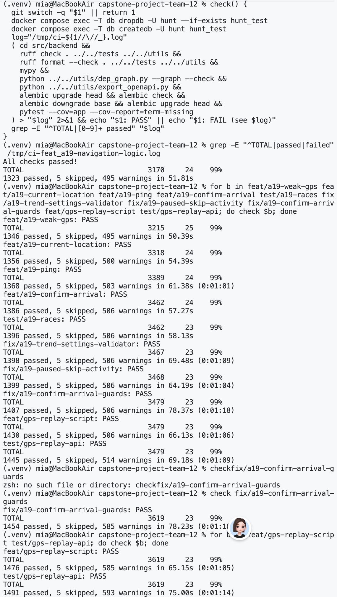

# Week 9 Individual Log

## Mia Kuang

Week 9 (Nov 2 – Nov 8)

**This week** I finished A19 (GPS guidance, issue #45) and started #46 (the GPS replay script). A19 is the six stacked PRs from last week (#305 to #310) and three follow-ups from the reviews (#318, #319, #320). Eddy and Fabiha approved all nine, and they were merged on Nov 8. GitHub Actions could not start on any of them because of the organization's billing issue, so I ran the same steps as ci.yml locally on every branch and posted the results as a comment. #326 and #327 are the two PRs for #46. They are open and waiting for review, so they only have a row in the table.

| PR | What | Files | Lines | Tests | Status |
|---|---|---|---|---|---|
| #305 | Stage 1 navigation rules | 4 | +497 / -0 | 13 | Merged Nov 8 |
| #306 | Weak GPS, the speed flag and the override time | 3 | +313 / -12 | 17 | Merged Nov 8 |
| #307 | `GET /games/{id}/current-location` | 5 | +497 / -2 | 8 | Merged Nov 8 |
| #308 | `POST /games/{id}/navigation/ping` | 9 | +484 / -3 | 9 | Merged Nov 8 |
| #309 | `POST /games/{id}/navigation/confirm-arrival` | 4 | +485 / -1 | 10 | Merged Nov 8 |
| #310 | Navigation race tests | 4 | +404 / -23 | 10 | Merged Nov 8 |
| #318 | The GPS trend reset must be longer than the trend interval | 2 | +16 / -0 | 1 | Merged Nov 8 |
| #319 | A paused skip starts the next clock but keeps the idle time | 2 | +30 / -2 | 1 | Merged Nov 8 |
| #320 | Refuse confirming a deactivated or non-navigating location | 7 | +269 / -41 | 8 | Merged Nov 8 |
| #326 | GPS replay script for walking routes | 3 | +469 / -0 | 8 | Open, waiting for review |
| #327 | Replay tests against the real routes | 5 | +356 / -2 | 13 | Open, waiting for review |

Lines are the numbers from git. Tests are new test functions; a parametrized test counts once. openapi.json and the dependency graph are not committed (CI generates them), so none of these sizes include them.

**One thing went wrong:** a deactivated location could still be confirmed into Stage 2. The skip for a deactivated location lived only in `GET /games/{id}/current-location`, so ping and confirm-arrival never checked it. Eddy found this while reviewing #308 and #309. It matters because in Stage 2 the student can finish the photo, so a location that should have been skipped with 0 points became playable. I fixed it in #320: ping and confirm-arrival now return 409 `STATE_CHANGED` and write nothing, and the app's next `GET current-location` does the skip. My first version of the fix still had a problem. It checked deactivation before the stage, so a COMPLETED or SKIPPED row on a deactivated location got `STATE_CHANGED`, the app called GET, GET doesn't skip those rows, and the next confirm got `INVALID_STAGE`. Eddy pointed this out on #320, and I changed the order so the stage is checked first. Eddy also found that the #320 description no longer matched the branch (three changes were missing from it), so I rewrote it. Lesson: when one place owns a rule, every action that touches the current location needs a test that goes through it, and the order of checks decides which error the app sees.

**A second thing went wrong:** GitHub Actions jobs would not start because of the organization's billing issue (not because of our code), so no PR had a CI result. I ran the same steps as ci.yml on each branch (ruff check and format, mypy, the dependency graph and OpenAPI checks, alembic upgrade, check and downgrade, and pytest with coverage), for example 1323 passed and 5 skipped on #305, and put the result in a comment. Because Actions could not run, I turned off the CI requirement for merging, and I asked the team to post their local test results on the PR they want to merge. The screenshot shows the `check` command I used and the result for each branch of the A19 stack, the three follow-ups and the two #46 branches. Every branch passed, from 1323 tests on #305 to 1491 on the last #46 branch.

## PR #305: The Stage 1 navigation rules (A19 part 1)

**Requirement:** issue #45 and the spec's Stage 1: Navigation (ping processing and feedback selection). This part is the pure rule that decides what a ping says.

**What I did:**

- `app/game/geo.py` has the haversine distance, the nearest entrance and the distance band (far, approaching, near, arrived). It doesn't use the database (Game)
- `evaluate()` in `app/game/navigation.py` is the rule for one ping. It compares the distance with a reference about 25 s old using a 10 m dead band (closer, farther or steady), always against the same entrance, and resets the reference after 60 s without a trend (Game)
- It picks one feedback code and decides whether it is spoken: `NAV_START` on the first fix, `NAV_ARRIVED` once when entering the radius (not again while wobbling on the edge), and trend codes only when a trend is evaluated. It never returns a direction (Game, frontend)
- New settings: `gps_trend_interval_seconds` 25, `gps_trend_reset_seconds` 60 and `gps_dead_band_meters` 10 (developers)

**Data modeling:** none. Keeping the rule pure means the 25 s and 60 s windows and the dead band are tested without a database or sleeping.

**Review:** I found two problems myself. A ping inside the radius after `NAV_ARRIVED` still reported a trend even though nothing was spoken, so it now returns `trend: null` like every other silent ping. The dead band was only tested at ±9.99 m and ±10.01 m, so I added a test for exactly ±10 m. Eddy asked for a settings validator, because nothing required `gps_trend_reset_seconds` to be longer than `gps_trend_interval_seconds` (that is #318). He also asked whether an accuracy gate was expected, and that is in #306. I kept one cosmetic suggestion as it was, because the result is identical, and I didn't add a bounds check, because the entrances are copied onto the row when the location is drawn and a shuffle creates a new row with fresh tracking. Fabiha and Eddy approved.

**Tests** (tests/backend/test_navigation_logic.py): 13 new tests. A walk toward the target at 1.4 m/s pinged every 5 s (TC1), the trend windows, the dead band at exactly ±10 m, and `NAV_ARRIVED` spoken once at the edge of the radius.

## PR #306: Weak GPS, the speed flag and the override time (A19 part 2)

**Requirement:** issue #45 (TC2: the GPS override before 3 minutes unless accuracy is poor) and the spec's Stage 1 (GPS quality, anti-cheat, Arrival).

**What I did:**

- A fix with accuracy over 50 m returns `NAV_GPS_WEAK`, doesn't update the trend and counts toward `weak_pings_in_row`. A good fix resets the count. A weak fix is never confirmable, even inside the radius (Game)
- `NAV_GPS_WEAK` is spoken on the first weak fix and then at most every 25 s (frontend)
- More than 10 m/s between two good fixes adds `speed_anomaly`. Weak fixes are skipped, because they jump around (Game)
- `override_available_at()` says when "Continue without GPS" is allowed: 3 minutes after the location became current, or the last ping's time once 3 pings in a row were weak (Game, frontend)
- New settings: `gps_weak_accuracy_meters` 50, `gps_weak_pings_for_override` 3, `gps_override_after_minutes` 3 and `speed_anomaly_mps` 10 (developers)

**Review:** I found four problems myself. A weak fix inside the radius could set `can_confirm`. Weak fixes jittering inside the radius after `NAV_ARRIVED` switched the phrase to `NAV_GPS_WEAK`. A signal flipping between good and weak repeated `NAV_GPS_WEAK` on every weak ping. A good fix right after weak ones kept showing `NAV_GPS_WEAK` until the next trend. All four are fixed and tested. Eddy found that `NAV_ARRIVED` could be spoken twice: a weak fix just outside the radius (32 m with a 30 m radius) spoke `NAV_GPS_WEAK`, and then the next good fix inside spoke `NAV_ARRIVED` again. After `NAV_ARRIVED`, a weak ping inside the dead band no longer resets it, and a repro test covers it. He also pointed out that a weak ping in between hides a speed jump. I didn't add "last good fix" columns, because the flag is not what stops cheating: anyone can confirm with the GPS override after 3 minutes, and points only come from the Stage 2 photo. The flag is a hint for teachers and never blocks play. I wrote the limitation in the PR description, and it is in the spec too. Fabiha and Eddy approved.

**Tests** (tests/backend/test_navigation_logic.py): 17 new tests. A weak fix is never confirmable, a flapping signal speaks `NAV_GPS_WEAK` at most every 25 s, a good fix after a weak one shows `NAV_KEEP_GOING` or `NAV_VERY_CLOSE` silently, exactly 10 m/s is not flagged, and the override time after 3 weak pings and after 3 minutes.

## PR #307: GET /games/{id}/current-location (A19 part 3)

**Requirement:** issue #45 ("Also in this card: GET /games/{id}/current-location"), the spec's API table and Content Changes During a Session, and DFD 2.2.

**What I did:**

- `current_row` in the new `app/game/progress.py` locks the row at `current_position` that a shuffle didn't replace (game first, then location). If there is none, it is 409 `INVALID_STAGE` instead of a 500 (Game)
- `move_on` makes the next location current, skips ones deactivated since the draw, and completes the game after the last one (clearing `paused_at`). A10 will call it when a photo finishes a location (Game)
- `GET /games/{id}/current-location` (`getCurrentLocation`) returns the position, the stage (navigation or verification), the clue audio link, attempts used and left, and `gps_override_available_at`. It never returns names, room numbers or coordinates. A paused game can be read (frontend)
- If the location was deactivated before the student got there, it is skipped (0 points) and the next one comes back. If that was the last one, the game completes and the response is the game status, until A23 (#47) has the summary (frontend)
- `make_session_location` in conftest now gives a clue recording that the stub audio service can link (developers)

**Data modeling:** a location already in Stage 2 is not skipped when it is deactivated, so the student can finish the photo. I added this to the spec.

**Review:** Eddy found that a skip on a paused game started the next location's clock and refreshed `last_activity_at`, so a paused student whose location was deactivated reset their 24 h expiry by calling GET. The idle time is fixed in #319. I kept the next location's 3-minute clock starting at the skip, because the override only skips GPS guidance and the student still has to pass the Stage 2 photo. Counting paused time also keeps the rule to one timestamp. Fabiha and Eddy approved.

**Tests** (tests/backend/test_current_location.py): 8 new tests. A shuffled row is ignored, a deactivated location is skipped and the next one returned, consecutive deactivated ones are skipped, a location in Stage 2 is not skipped, the last location deactivated completes the game, a paused game can be read, and the body has no coordinates.

## PR #308: POST /games/{id}/navigation/ping (A19 part 4)

**Requirement:** issue #45 and the spec's Stage 1 ping processing and Rate Limits (one ping every 2 s per session), DFD 2.2 to 2.4.

**What I did:**

- Migration `9d4b6e2a1f73` adds `session_locations.weak_pings_in_row` (smallint, default 0, check >= 0). A shuffle creates a new row, so the count starts again (developers)
- `POST /games/{id}/navigation/ping` (`sendNavigationPing`) takes `lat`, `lng` and `accuracy_m`. It returns the trend, `can_confirm`, `speak`, one feedback code with its audio link, and `gps_override_available_at` (frontend)
- Errors: 409 `SESSION_NOT_ACTIVE` for a paused or finished game, 409 `INVALID_STAGE` unless the location is in Stage 1, 429 `RATE_LIMITED` less than 2 s after the last ping, and 422 for out-of-range coordinates, a negative accuracy or Infinity (frontend)
- `GET current-location` now uses the real weak-ping count (Game)
- A shared `navigating_game` fixture in conftest, used here and in the next PR (developers)

**Data modeling:** the weak-ping count is a column because the override rule needs it across requests. The ER diagram only lists key columns, so it stays the same. The Game Session DFD (2.2 to 2.4) was updated.

**Review:** Eddy found that a ping on a deactivated location kept returning normal feedback and `can_confirm` until the next GET, because `process_ping` never skips. It is fixed in #320: the ping returns 409 `STATE_CHANGED` and writes nothing. I kept the skip out of the ping, so the ping response doesn't need a second "moved on" shape. He also had a point about the weak-ping rule that I fixed in #306, and one I left as it was, because a game only starts when every feedback phrase exists in its language. Fabiha and Eddy approved.

**Tests** (tests/backend/test_navigation_ping.py): 9 new tests. The response fields, the 2 s rate limit at its boundary, a paused or finished game, a location in Stage 2, out-of-range and Infinity input, and the weak-ping count and override time after the ping.

## PR #309: POST /games/{id}/navigation/confirm-arrival (A19 part 5)

**Requirement:** issue #45 and the spec's Stage 1: Arrival and the API and error tables, DFD 2.4.

**What I did:**

- `confirm_arrival` in the new `app/game/arrival.py` and `POST /games/{id}/navigation/confirm-arrival` (`confirmArrival`). Without an override, the last ping must be under 30 s old (409 `STALE_POSITION`) and inside the radius (409 `NOT_WITHIN_RADIUS`). A weak last fix is also `NOT_WITHIN_RADIUS`, with the detail reason `gps_weak` (Game, frontend)
- `override_reason: gps_unavailable` works from `gps_override_available_at` on (3 minutes, or 3 weak pings in a row), otherwise 409 `GPS_OVERRIDE_NOT_ALLOWED`. An accepted override is saved in `arrival_override` and flagged `gps_override` for the teacher (Game, frontend)
- Success moves the location to Stage 2 and returns the current location plus `VERIFY_START` (frontend)
- It is safe to repeat: once in Stage 2, the same body comes back and nothing is written, even if the game is paused. An optional `position` gives 409 `STATE_CHANGED` if it doesn't match, so a late retry can't confirm the next location (Game)
- New setting `arrival_ping_max_age_seconds` 30 (developers)

**Review:** Eddy found that a deactivated location could be confirmed into Stage 2, and also asked for `position` to be required and for non-navigating rows to be refused first. All three are fixed in #320. Fabiha asked for a test for a confirm after a shuffle, which I added in #320 (see there). Fabiha and Eddy approved.

**Tests** (tests/backend/test_confirm_arrival.py): 10 new tests, including TC2. A ping older than 30 s is `STALE_POSITION`, outside the radius is `NOT_WITHIN_RADIUS`, the override before 3 minutes is refused, 3 weak pings allow it, then 1 good ping refuses it and 3 minutes allow it again, the override is flagged, and a repeat in Stage 2 returns the same body.

## PR #310: Navigation race tests (A19 part 6)

**Requirement:** issue #45. This PR closes #45. Confirm, ping, shuffle and quit all rely on row locks, so they are checked with real concurrent requests.

**What I did:**

- `tests/backend/test_navigation_races.py` has real-Postgres races, each request in its own committed transaction. Two confirms at once agree and record one override, a ping after a confirm is `INVALID_STAGE`, two pings within 2 s give one `RATE_LIMITED`, confirm after pause or quit and ping after quit are `SESSION_NOT_ACTIVE`, a ping after a shuffle starts the new row, a confirm after a shuffle is `STALE_POSITION`, and two `current-location` calls skip deactivated rows only once (developers)
- A test that `move_on` ignores rows a shuffle replaced (developers)
- A shared `run_together` fixture in conftest runs jobs at the same moment, each in its own thread and session, with an optional delay so one takes its lock first. It also replaces the thread code in `test_email_links.py` (A3, resend-verification race) (developers)

**Review:** Eddy removed the locks (`with_for_update` in `current_row` and `lock_open_game`) to see whether the tests catch it, and 8 of 9 race tests failed. The two-confirms test passed without the locks, because its assertion depended on the order of the jobs. It now asserts that `arrived_at` and `last_activity_at` were written before the second job started, and it fails without the locks. He also asked for an assert that an active ja/basic location is seeded and a comment explaining the `HOLD` timing, and I added both. After that all 9 race tests fail without the locks. Fabiha and Eddy approved.

**Tests:** 10 new tests (9 races in `test_navigation_races.py` and the `move_on` test in `test_current_location.py`). The email race test checks the same thing as before and now also checks that every request returns normally.

## PR #318: The trend reset must be longer than the trend interval (A19 follow-up 1)

**Requirement:** Eddy's review on #305. #45 and the spec's Stage 1.

**What I did:**

- A settings validator in `app/config.py`: `gps_trend_reset_seconds` must be longer than `gps_trend_interval_seconds`, or the settings don't load. With a reset of 20 s and an interval of 25 s, no trend could ever be produced, and nothing caught it (developers)

**Review:** Eddy and Fabiha approved. It was split out to keep #305 under the 500-line limit.

**Tests** (tests/backend/test_config.py): 1 new test that 20/25 and 25/25 are both rejected.

## PR #319: A paused skip starts the next clock but keeps the idle time (A19 follow-up 2)

**Requirement:** Eddy's review on #307. #45 and the spec's Content Changes During a Session.

**What I did:**

- `skip_if_deactivated` in `app/game/progress.py` no longer updates `last_activity_at` when `GET current-location` skips a deactivated location on a paused game, so a GET while paused doesn't extend the 24 h expiry. It still skips the location and starts the next location's clock, because paused time counts. An active game works as before: the skip counts as a game action (Game)

**Review:** Eddy and Fabiha approved.

**Tests** (tests/backend/test_current_location.py): 1 new test. A paused game skips the deactivated location, starts the next one, stays paused and keeps its `last_activity_at`.

## PR #320: Refuse confirming a deactivated or non-navigating location (A19 follow-up 3)

**Requirement:** Eddy's reviews on #308 and #309. #45 and the spec's Stage 1: Arrival and Content Changes During a Session (updated).

**What I did:**

- `confirm_arrival` checks, in this order: the request position first (a missing position is 422, a mismatch is 409 `STATE_CHANGED` and nothing is written), then a repeat once the location is in Stage 2 (the same body, no writes, even if the location is inactive), then a row that isn't navigating (409 `INVALID_STAGE`), and then a navigating row whose location was deactivated (409 `STATE_CHANGED`, no writes) (Game, frontend)
- A ping on a deactivated location that is still navigating is 409 `STATE_CHANGED` and writes nothing (frontend)
- `position` is required on confirm-arrival, not only recommended (frontend)
- The speed check between two stored good fixes uses `max(0, distance − accuracy of both fixes) / time` and flags `speed_anomaly` only over 10 m/s. A weak fix is stored as the latest ping and is not speed-checked, and the good ping right after it isn't either (Game)
- The route docs in `app/api/v1/games.py` list the new errors. The test fixtures pick a real active location, because a random location id now counts as deactivated (developers)

**Data modeling:** deactivated locations are skipped in one place only (`GET current-location`). Ping and confirm refuse instead of skipping, so the response needs no second shape.

**Review:** Eddy asked for the description to match the branch and to list the three changes it was missing (`position` required, the ping on a deactivated location, and the speed check), and I rewrote it. He also found the check order problem described above. Fabiha asked for a test for a confirm after a shuffle, and I added `test_a_confirm_after_a_shuffle_needs_a_ping_on_the_new_location`: after a shuffle replaces the current location at the same position, a confirm gets 409 `STALE_POSITION` and nothing changes. Eddy ran the full backend pytest (1342 passed, 6 skipped), strict mypy and `ruff format --check` on the tip, and approved. Fabiha approved too.

**Tests** (tests/backend/test_confirm_arrival.py and others): 8 new tests. A deactivated navigating location is `STATE_CHANGED` and changes nothing, a COMPLETED or SKIPPED row with an inactive location is `INVALID_STAGE` and writes nothing (full game and row snapshot), a pending row is `INVALID_STAGE`, a repeat in Stage 2 returns the same body twice with no writes (also when inactive), a ping on a deactivated location is 409, jitter inside both accuracy circles doesn't flag speed, and the shuffle test above.

## Other work this week

- **Spec and issues:** I updated the spec for the A19 follow-ups (ping and confirm refuse a deactivated location, `position` is required). I opened #326 and #327 for #46. #326 adds `utils/gps_replay.py`, which plays a recorded walking route (a CSV of time, position and accuracy) against a student's game through the public API and prints the feedback code for each ping. It checks the route file before sending anything, stops when the game changes, and uses only the standard library. #327 tests it against the real routes, so a walk of several minutes runs at once with a frozen clock, and the README explains how to run it.
- **CI:** GitHub Actions could not start because of the organization's billing issue, so I turned off the CI requirement for merging and asked the team to post local test results on the PR they want to merge, with the commands to run.
- **Reviews:** I reviewed 8 PRs by Eddy, Fabiha and Kaedyn. On Nov 2 I approved Fabiha's #298 and #299 (the A12 points and achievements endpoints) after the changes I asked for last week, and they were merged on Nov 8. On Nov 8 I approved her #300 (the scoring helper), which is still open. For Eddy's A20 routes I approved #304, asked for changes on #301 and #321, and left comments on #303. I also asked for changes on Kaedyn's #314 (rate limiting).
- **Next week:** get #326 and #327 reviewed and merged. We will also divide up the work for the client demo and continue with the later part of the project. For A10, a test that a verification result can't be written to a shuffled row.
