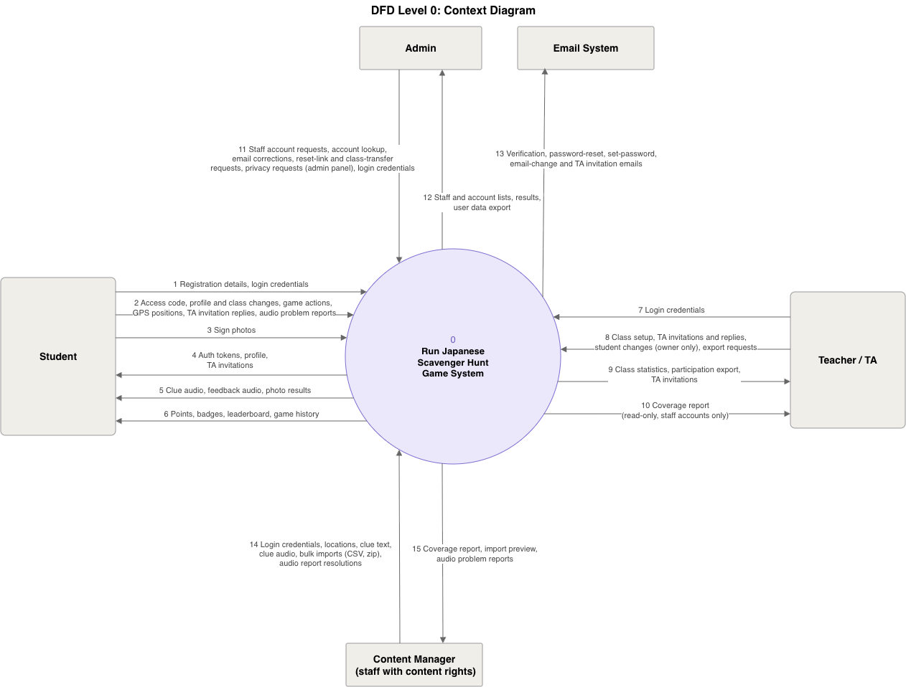
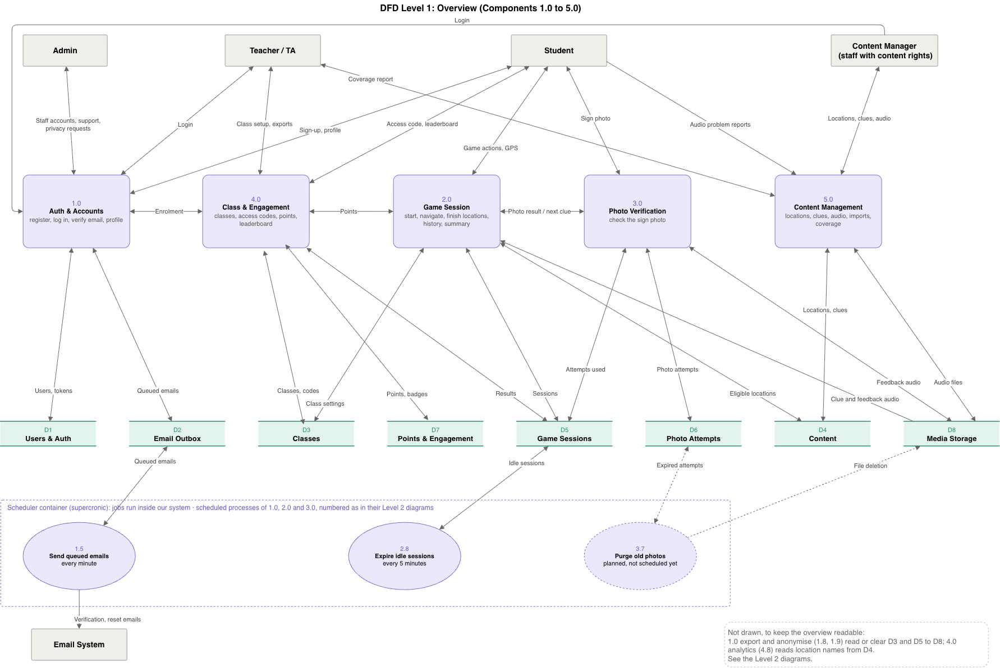
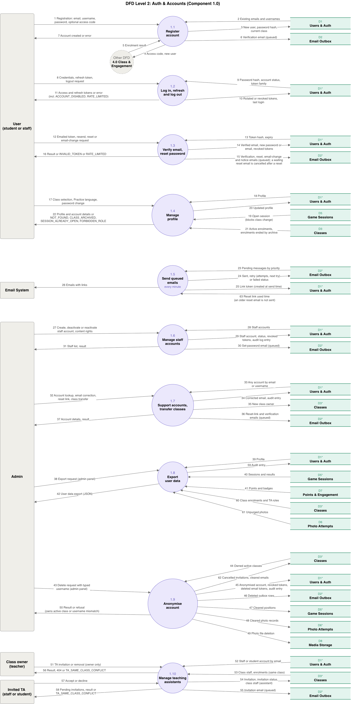
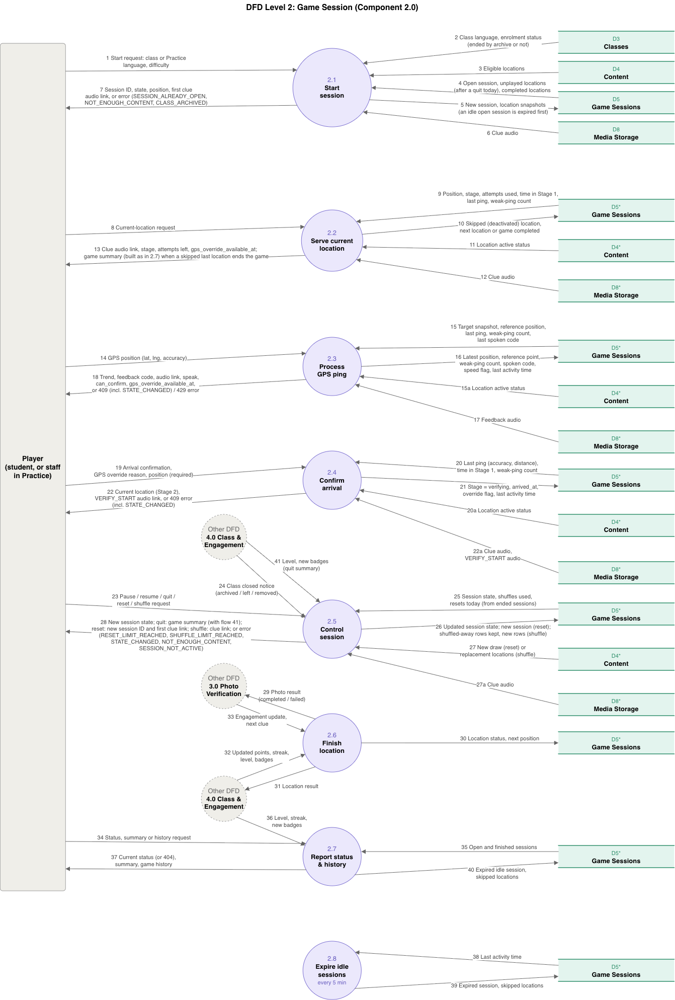
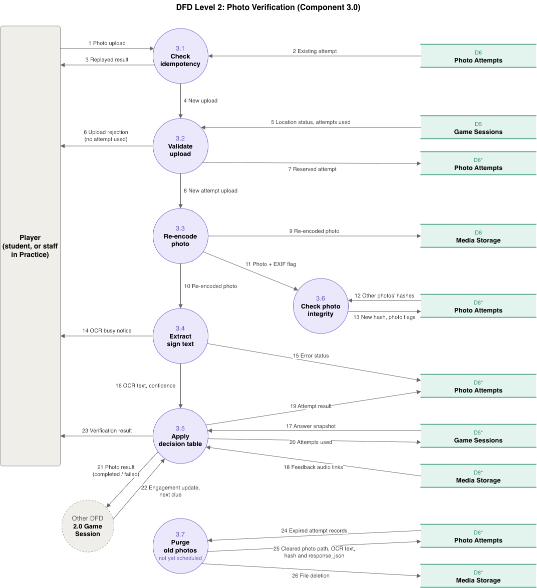
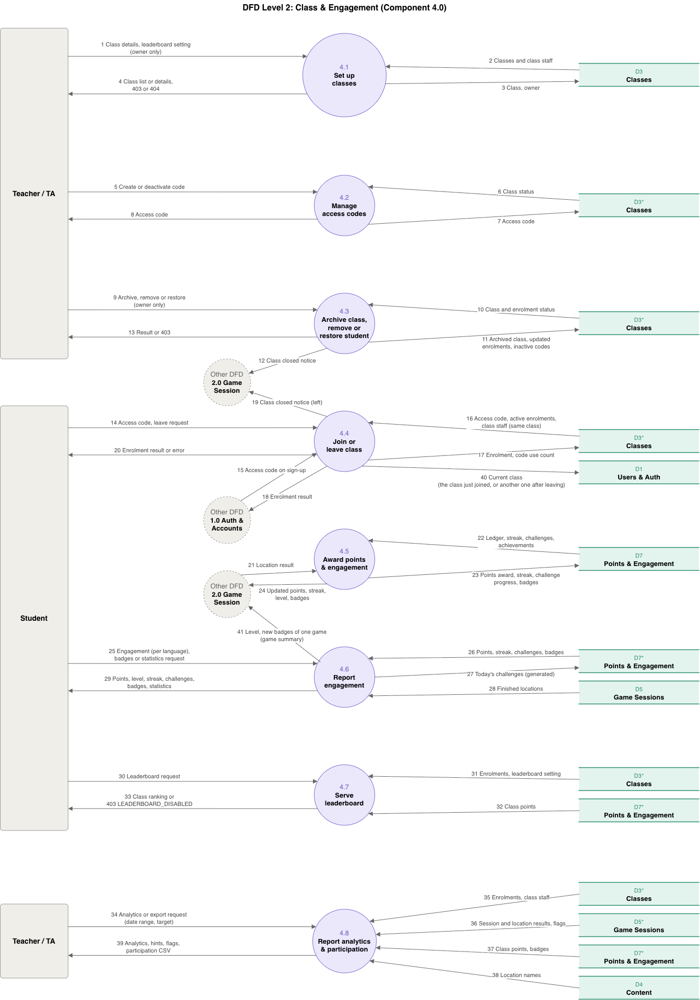
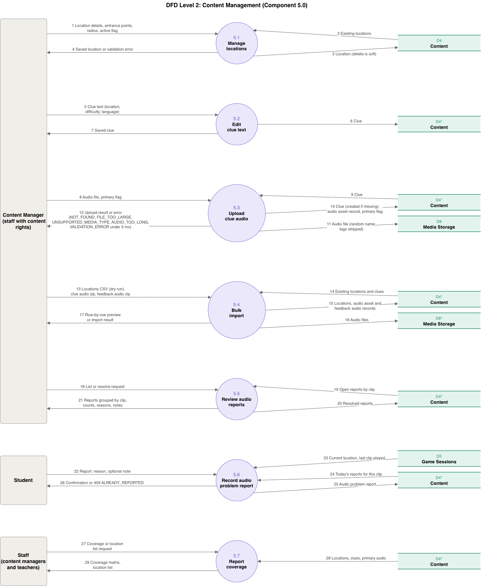
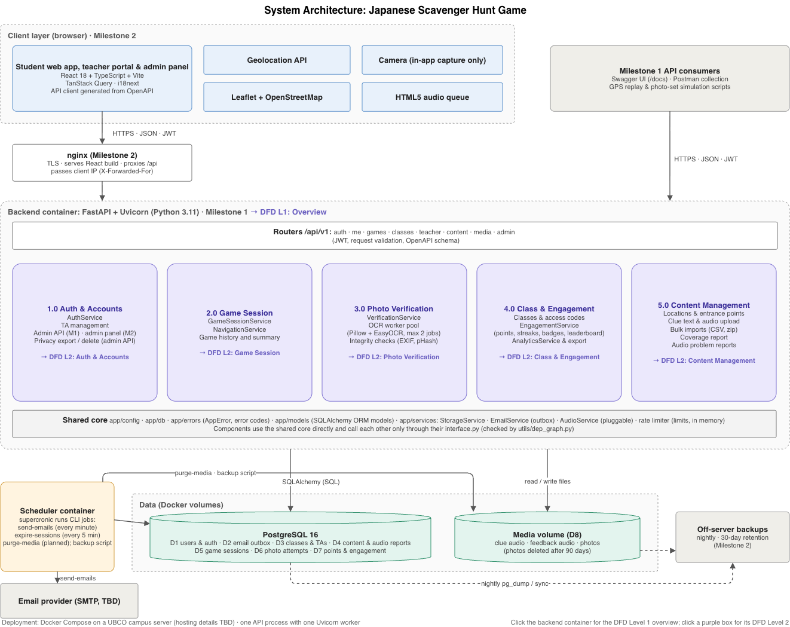

# Week 11 Team Log (Nov. 16 - Nov. 22)

Authors: Mia Kuang

## Goal

This week, we decided to focus on merging the stacks left open in week 10, with the goal of running the client demo on the real backend on Nov 19. The stacks were photo verification (A10), streaks and challenges (A13), the class leaderboard (A14), class analytics (A16), content from the database (A20) and the account routes (A22, A24). We also planned to remove repeated code and update the DFDs and the system architecture (observed: week 10 team log).

## Work distribution

Only PRs merged into `origin/main` between Nov 16 and Nov 22 count as merged. Details are in each person's individual log.

- **Mia** focused on rate limits (#322), class staff checks on the routes (#378), the A4 response scan (#71) and CI.
  - *Merged:* 11 PRs, 50 files, +1,087/-657: #375, #377, #379, #380, #383, #388, #390, #392, #394, #396 and #399. See `logs/MiaKuang/week-11.md`.
  - *Not merged yet:* #401, #402, #403, #404, #442, #446 and #451.
- **Eddy** focused on photo verification (A10) and reading content from the database (A20).
  - *Merged:* 17 PRs, 81 files, +4,369/-825: #301, #303, #321, #341, #342, #344, #346, #374, #376, #386, #387, #391, #397, #398, #405, #408 and #409.
  - *Not merged yet:* #296 and #304.
- **Fabiha** focused on streaks and challenges (A13), the class leaderboard (A14) and class analytics (A16).
  - *Merged:* 14 PRs, 60 files, +4,838/-144: #356, #357, #359, #360, #362, #363, #365, #367, #369, #370, #371, #372, #382 and #384.
  - *Not merged yet:* 14 PRs for the A5, A6, A12, A16 and A17 follow-ups.
- **Kaedyn** focused on the account routes (A22, A24) and the admin API (A27).
  - *Merged:* 2 PRs, 7 files, +458/-11: #323 (logout) and #324 (profile).
  - *Not merged yet:* #325, #410, #415, #439, #440 and #445.

We considered two other workload distributions (Mia considered). First, #322 could have stayed with Kaedyn, who wrote the first rate limit. Mia took it because Kaedyn's admin API (A27) was already late. Second, Mia could have taken over A21 (#77) as well, since Eddy's photo purge (#94) is blocked on it. We kept A21 with Kaedyn and asked him to do it first. All of his remaining work must be merged, not just opened, by Nov 29. Anything not merged by then moves to the rest of the team. If that happens, we will all talk to the professor at office hours on Dec 3 about how the work is split.

## Client demo branch (not on main)

Mia and Eddy built a small web app for the Nov 19 client demo on `demo/client-demo`. It is not merged and doesn't count above: M1 is backend only, and the real web app comes in M2. It has 19 commits, 15 files and +2,801 lines (observed: branch log).

- **Mia** wrote the app shell, the API client and the student and teacher screens: login, joining a class, the game, history, the leaderboard and class analytics. She also added the class switcher, every badge with locked ones dimmed, and analytics labelled by room.
- **Eddy** wrote the photo module: taking or uploading a photo and showing the result.

The demo ran on the real backend from Mia's machine, and we played it on our phones. We will reuse the branch with the latest main for the final presentation.

## Goal evaluation

Based on the merged PRs on main, we met most of the goal (observed: main log). 44 PRs were merged: 17 by Eddy, 14 by Fabiha, 11 by Mia and 2 by Kaedyn.

- **Met:** a game can now finish a location from a photo, with content read from the database. Streaks, daily challenges, the class leaderboard and class analytics are on main. #322 (rate limits) and #71 (A4) are closed. The Nov 19 client demo ran on this code (see above).
- **Not met:** the admin API (A27) and change password are still open. Most of the repeated-code refactors are open too.
- **Challenges:** most stacks merged on the evening of Nov 17. Three of us reviewed and merged them together, just before the demo. Reviews of the newer stacks came on Nov 21 and 22.
- **Over the size limit:** #372 (participation export) changed 565 lines. The export and its tests landed in one PR (inferred from its diff).
- **Files over 500 lines:** `api/v1/classes.py` grew from 470 to 745 lines with the A16 routes. `engagement/interface.py` (726), `tests/backend/conftest.py` (686) and `tests/backend/test_engagement_interface.py` (812) were already over and grew. Each holds one kind of code for a whole component. Splitting them by feature is a follow-up.
- **Plan for next week:** merge the open PRs early in the week, then the work in Next week.
- **Limitation:** two merged PRs don't show how far Kaedyn's work is behind. Sign-in (A2) is still open from M1-1, due Oct 11. A27 was due Oct 25, and its first PRs opened on Nov 19 (observed: PR list). He has merged 15 PRs into main this term, against 39 to 85 for each of the rest of us.

## Code quality

- **Similar logic implemented multiple times:** Mia ran a duplicate-code scan on main and checked it by hand (#400). It found repeated game errors, class name checks and staff lookups. Therefore, Mia opened #404 and #446, which are not merged yet. On main, #388 removed four copies of the class role query. Eddy's #386 lets the photo route reuse the game actions' runner instead of copying it (DRY).
- **Many dependencies between modules:** `utils/dep_graph.py --check` passes at the end of the week (observed: 88 modules, 371 import edges, no rule broken). The photo route links game and verification through their interfaces only.
- **Changes in one component require changes elsewhere:** only #388 changed two components (observed: files changed per PR). It moved the role checks out of four engagement services into one accounts dependency. Engagement can't import accounts, so the check had to move to the routes.

Now, the team can confirm that the merged code has no new repeated logic and no rule-breaking dependencies. The remaining duplication is tracked in #400 and #354.

## DFD

We updated the DFDs this week, based on main as of Nov 19.

- **Level 0 (context):** **Updated.** The Scheduler is no longer an external entity, because it runs inside our system. Content Manager is now labelled as a staff account with content rights, not a fourth account type.
- **Level 1 (overview):** **New.** It shows the five components, the flows between them, the stores D1 to D8 and the scheduler container. Its flows were checked against every Level 2 diagram.
- **Level 2:** the component diagrams were renamed from Level 1 to Level 2.
  - 1.0 Auth & Accounts: 1.5 Send queued emails **Updated** (runs every minute; skips a reset email whose link was already used). Other processes (not changed).
  - 2.0 Game Session: 2.2 Serve current location and 2.5 Control session **Updated** (quit and a skipped last location return the game summary). 2.8 Expire idle sessions **Updated** (every 5 minutes). Other processes (not changed).
  - 3.0 Photo Verification: 3.7 Purge old photos **Updated** (marked not yet scheduled). Other processes (not changed).
  - 4.0 Class & Engagement: 4.6 Report engagement **Updated** (sends a game's level and badges to the game summary). Other processes (not changed).
  - 5.0 Content Management: **Updated** (the Content Manager entity is labelled as a staff account with content rights). Its processes (not changed).

We considered one alternative data flow (AI-suggested): the overview could show every store read by each component. We left the export and anonymise reads out and listed them in a note, so the overview stays readable.

## System architecture

We updated the system architecture diagram this week.

- **Rate limiter:** the shared core now lists "rate limiter (limits, in memory)" instead of slowapi (#392). slowapi never limited any `/api/v1` route on FastAPI 0.142, and its 429 handler used slowapi's private API. The counters live in the API process, which matches our one-worker deployment.
- **nginx:** the box now says it passes the client IP in `X-Forwarded-For` (#396). The per-IP limits need the real client address behind the proxy.
- **Links:** each component box now opens its Level 2 diagram, and the backend container opens the Level 1 overview.
- **Alternative components:** we could have kept slowapi and patched its middleware (AI-suggested). We dropped it because the fix would still depend on its private API.
- **Alternative dependencies:** the counters could live in Redis, so several API workers share them (AI-suggested). We kept them in memory because the spec runs one worker, and Redis would add a container.

## Collaboration process

We changed our process in two ways. First, we reviewed and merged the waiting stacks together on the evening of Nov 17. Second, CI can now run several jobs on one VM (#377), so runs don't queue behind each other.

The reason was the backlog. Most stacks had waited a week for reviews and had to merge before the demo. We considered keeping one reviewer per stack (AI-suggested). We dropped it because one person couldn't review every stack in time.

## Next week

We will:

- **Merge** the open follow-ups and the admin API early in the week, so fixes have time to land.
- **Finish** the remaining account work, starting with A21, by Nov 29 (see Work distribution).
- **Act on feedback:** Basic games stay in one building (client), and clue plays are recorded (professor).
- **Update** the diagrams for the new features, and keep the README in step with main.
