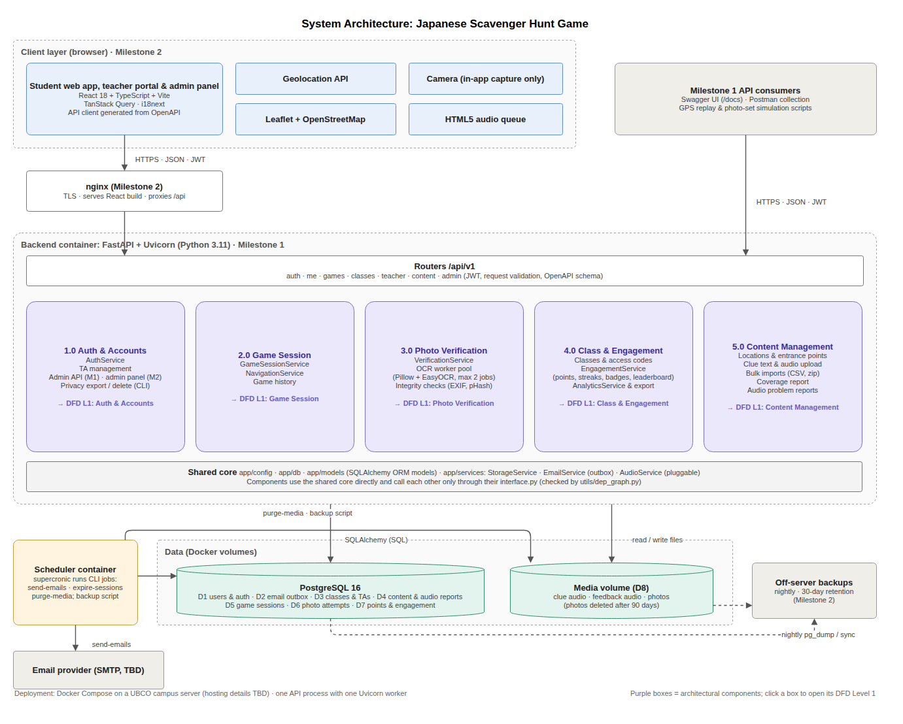

# Week 4 Team Log (Sep 28 – Oct 4)

This week, we decided to focus on finishing the design (fixing conflicts between the proposal and the tech spec, updating the architecture diagram and DFDs) and setting up the backend foundation, with the goal of everyone being able to start their Milestone 1 features next week on one shared design and code base.

The work was distributed so that Mia focused on the design review, the diagrams, the GitHub Project board (115 issues with owners and due dates), the backend skeleton (#122 to #126, #130) and the component packages with dependency rules (#132 to #135). Eddy focused on the EasyOCR spike: getting EasyOCR to run in our Docker image (#136) and testing it on real room-sign photos (#140). Kaedyn focused on the API conventions (#127), and Fabiha focused on the CI pipeline and test setup (#128).

We considered splitting the work by layer (everyone does backend first, then frontend), but we kept the feature-area split from the proposal so each person owns one area end to end. We balanced it by estimated effort instead of number of requirements, and moved the profile page (B24) from Kaedyn to Fabiha to even it out.

Based on the 14 merged PRs (#122 to #128, #130, #132 to #136, #140), we met this goal because the backend now starts with one `docker compose up`, CI runs on every PR, the API conventions are agreed, every component has its own package, and EasyOCR works in Docker (10 of 11 real sign photos read correctly).

The team agreed on one repo structure, branch naming, and a CI pipeline (ruff, mypy, pytest) every PR has to pass. Each component is its own package and other components can only use it through `interface.py`, and `utils/dep_graph.py --check` fails the PR if someone imports another component's internals or creates a cycle. By running the checker on the real backend, Mia found that `app/cli` wasn't in any group, so she added it to the entry layer. She also found that TA invitations and audio problem reports were in the wrong components, which would have caused changes across components, so she moved them to accounts and content (#134, #135). Now, the team can confirm that the code base does not contain any of the following:
- similar logic implemented multiple times
- many dependencies between modules
- changes in one component require changes elsewhere

With everyone's newly merged work for this week, the system DFD looks like the updated Level 0 and Level 1 diagrams below. The specific changes include TA management moving to 1.10 in Auth and audio problem reports to 5.6 in Content (to match who owns them), a new 1.7 for admin account support, bulk imports in 5.0 done by the content manager, and removing the skip flow from 2.0. We considered keeping a skip button, but dropped it because students could skip the listening part, and shuffle plus the attempt limit already stop them from getting stuck. We also considered an admin command-line import, but content managers need to update content themselves.

With everyone's newly merged work for this week, the system architecture diagram looks like the updated diagram below. The specific changes include a shared core box (config, db, models, services) since #135 moved models and services there, TA management in 1.0, audio reports and bulk imports in 5.0, and links from each component box to its DFD. We considered a command-line-only admin tool, but day-to-day account support needs to work for non-developers. We considered running OCR in a separate worker with a job queue, but kept it in the API process for Milestone 1 because the load is small. Eddy's spike (#140) measured about 3.6 s and 1.7 GB per photo, so we still need to load test two jobs at once.

We changed our collaboration process so that everyone reviews PRs instead of only the two assigned reviewers, and moved our meeting to Monday at 8 pm online. The reason we did this is that most PRs were opened after Thursday, and reviews piled up at the end of the week. We considered keeping fixed review days, but that was too slow when everything came in at once.

## Diagrams

Source files (draw.io) are in our [Drive folder](https://drive.google.com/drive/folders/1nHJDhfVOvWCLNEbqzlOMssgTrlTugm7J?usp=sharing).

### System architecture

### DFD Level 0

### DFD Level 1

