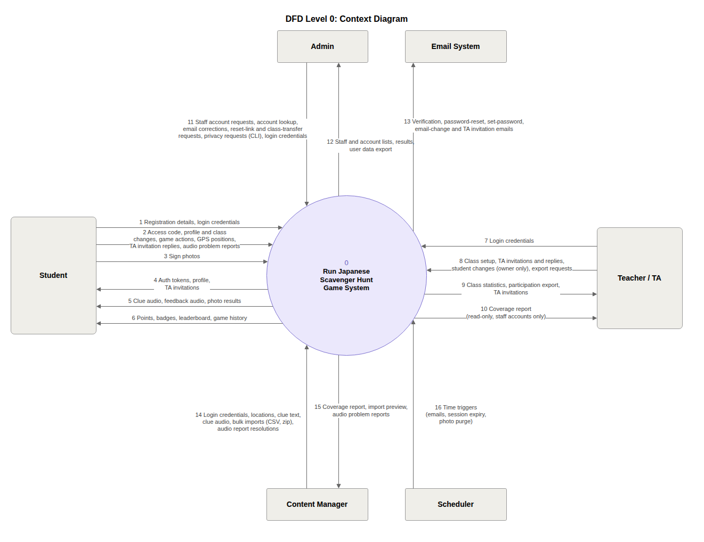
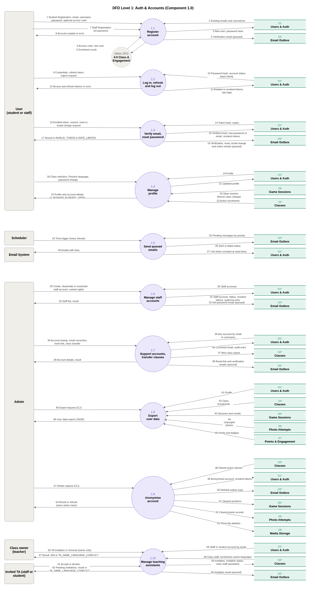
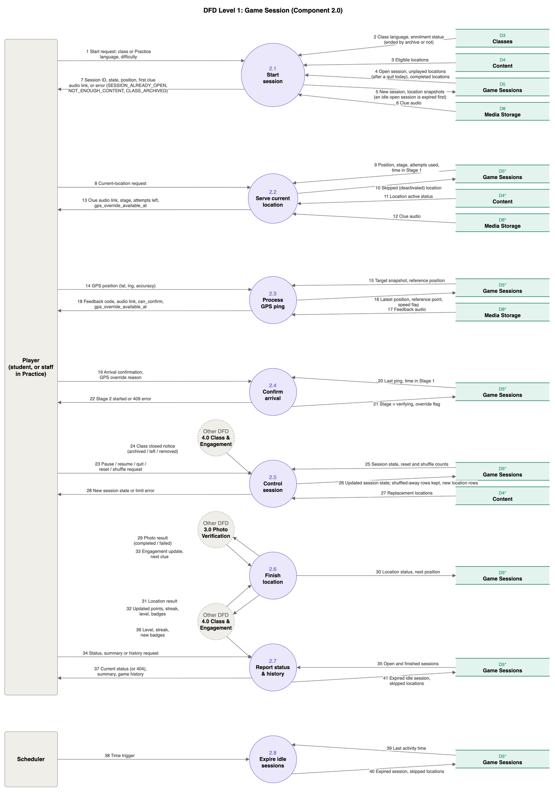
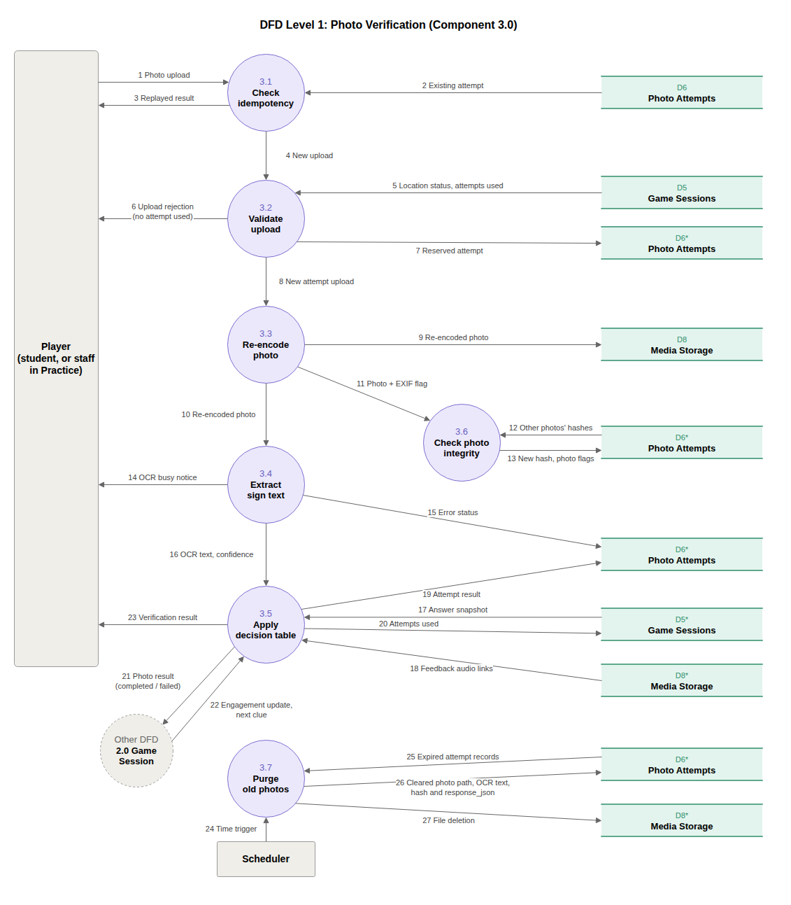
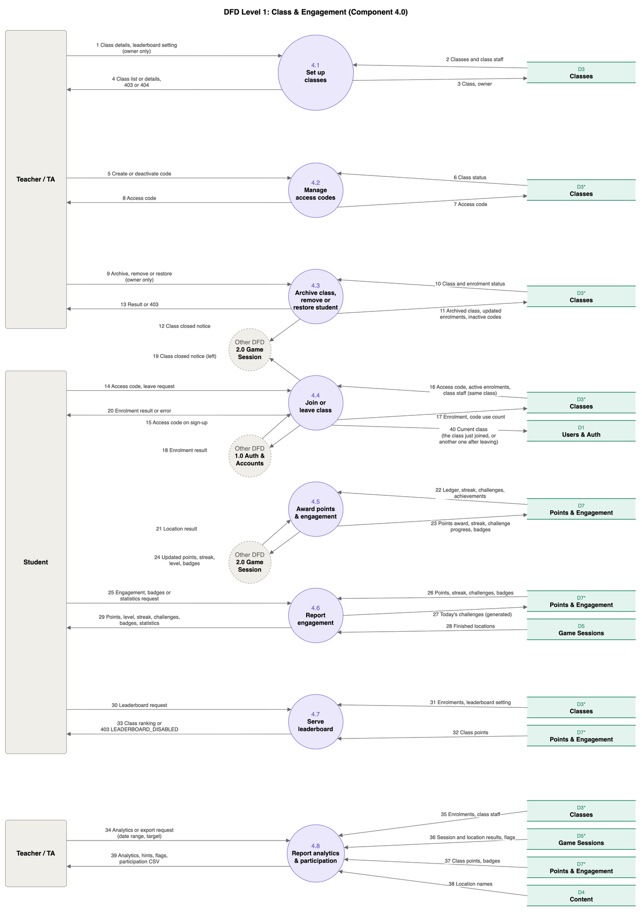
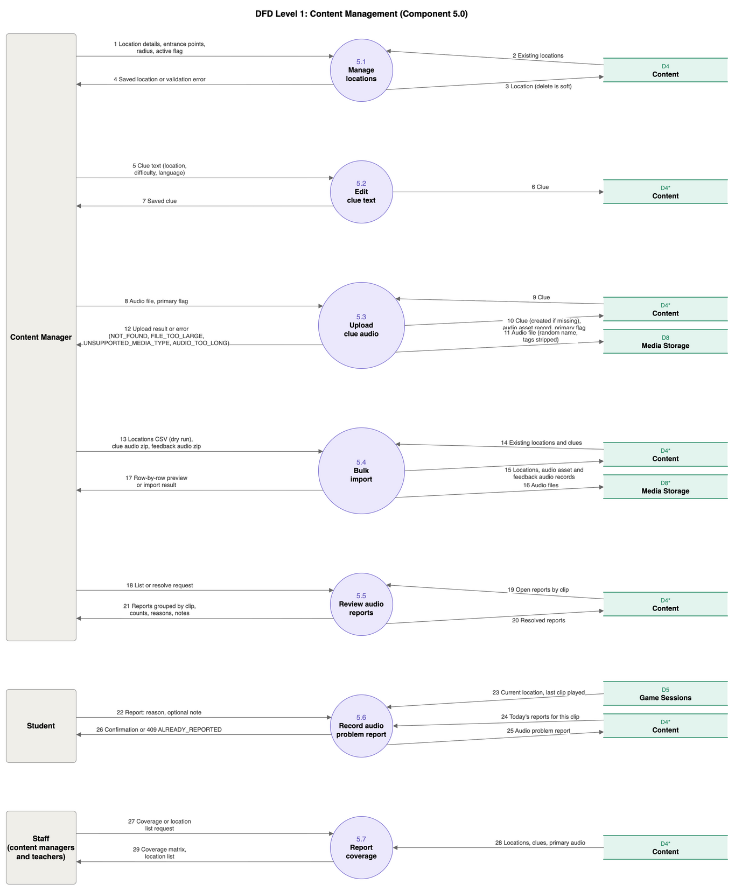

# Week 6 Team Log (Oct. 12 - Oct. 18)

Author: Kaedyn Hindley

This week, we decided to focus on expanding on the shared interfaces and individual components and authorization system, with the goal of beginning work on the core systems that will allow the game to function, while minimizing waiting on each other's work.

The work was distributed so that:

- Mia focused on assisting Kaedyn with the email system for account verification, password reset, and TA invitation (#175, #176, #183, #184, #185, #186), and after finishing that moved on to the foundations of the core game logic, such as starting both a private practice or class game session, and abandoning games in progress (#187, #188, #194). Mia also implemented CI files `utils/export_openapi.py` and `.github/workflows/ci.yml` that build the `docs/api/openapi.json` file and ensure that it is up to date so that changes to the API structure are more easily accessible during PR reviews (#179). At the end of the week she did the same for the dependency graph (#209, see below).

- Eddy focused on the storage service for the system (#177), allowing the system to write and find media files without their media URL revealing a location or answer. In addition, Eddy added locations and clues schemas to the shared models (#189). Eddy also refactored the system so that interfaces always have their db parameter as the last required parameter in all of their signatures (#178).

- Kaedyn focused on turning the functions in the accounts interface into FastAPI dependencies, allowing API endpoints to enforce role-based access (#180, #181), and on the sign-in system utilizing JWT for access tokens and rotating refresh tokens, with the goal of completing the basic authorization system. However, only the dependencies were finished on time.

- Fabiha focused on expanding the engagement component interface with the `EngagementResult` that is used by Eddy and Mia after processing a location's result (#190). Fabiha also implemented the join class endpoint, classroom creation and listing, and access code creation and deletion (#193, #201, #202, #203, #204).

We considered alternative workload distributions such Kaedyn implementing the email system as originally planned, but due to the urgency of finishing the FastAPI dependencies and sign-in system, Mia offered to assist.

Based on the 15 merged PRs, we mostly met this goal because important shared systems for core user interactions were implemented:

- **Accounts**: email system and user authentication dependencies. The goal for user sign-in was not met, however.
- **Engagement**: shared interface for points/achievement tracking, as well as classroom and access code creation
- **Content**: Media saving, locating, and schemas for locations and clues
- **Game**: Creation and abandoning of games, carry over of locations

The team collectively did the following to keep the code base free of repeated logic and tangled dependencies:

- **Role-based auth dependencies (#180, #181):** The old accounts interface functions returned bools or a user, making other components that depended on these need to implement their own handling of outputs. With this approach, routes that use these only need to call them as dependencies, and they will handle themselves by raising errors should a user not be authenticated.
- **One function for ending games (#194, #188):** Games can end in three ways: a class is archived or a student leaves, a student starts a new game while an old one is idle, and later the expiry job (A8). `abandon_sessions` in `app/game/sessions.py` does the ending for all of them, with the reason passed in (`class_closed` or `expired`). `is_idle` is also the only place that decides what "idle" means, and it has a version that works as a WHERE condition so the expiry job can pick its games in one query. `end_open_sessions` and `start_game` both use them, so the rules cannot drift apart.
- **Archive status through engagement (#194):** `start_game` needs to know whether a student's enrolment ended because the class was archived. Instead of reading the enrolment table and its `end_reason` itself, game calls `enrolment_ended_by_archive` in the engagement interface, so only engagement knows how enrolments are stored.
- **One way to send email (#175, #176, #185, #186):** Registration, verify email, forgot password and reset password all call `EmailService.queue_email`, which writes a row to the outbox, and one job sends them (#183, #184). The rule "one pending reset per user" is written once as `ONE_PENDING_RESET_WHERE` in `app/models/email.py`, and both the database index and `EmailService` use it.
- **Database argument always last (#178):** Every interface function takes `db` after its required arguments, so callers do not have to remember a different order for each component.
- **API documents generated from the code (#179):** `docs/api/openapi.json` is built by `utils/export_openapi.py`, and CI fails if the committed file does not match the code. Nobody edits the API description by hand, and a route change and its description always arrive in the same PR.
- **Dependency graph generated and checked (#209):** `docs/architecture/dependency-graph.md` is drawn from the imports by `utils/dep_graph.py --graph`. It was not being redrawn: the committed version still said 16 modules and 2 import edges. We redrew it and made `--check` fail in CI when the file is out of date, so a PR that adds or moves an import has to commit the new graph. The same check also enforces our rules: components only import each other through `interface.py`, there are no cycles, and shared code never imports a component. The new graph has 42 modules and 106 import edges and no rule is broken.

Now, the team can confirm that the code base does not contain any of the following:

- similar logic implemented multiple times
- many dependencies between modules
- changes in one component require changes elsewhere

With everyone's newly merged work for this week, the system DFD looks like the updated diagrams below. The specific changes are in the game session and auth diagrams, so that they match the code and the new dependency graph.

- In 2.0 Game Session, flow 2 now also returns whether the student's enrolment was ended by an archive, which is how start-game tells `CLASS_ARCHIVED` apart from `NOT_FOUND` (4.0 answers through `enrolment_ended_by_archive`). Flow 4 reads the student's open session, the locations left unplayed after a quit today and the completed locations, which the draw needs for carry-over. Flow 5 writes the new session and its location snapshots, and an idle open session is expired first. Flow 7 returns the session ID, state, position and the first clue's audio link, or one of `SESSION_ALREADY_OPEN`, `NOT_ENOUGH_CONTENT` and `CLASS_ARCHIVED`.
- In 1.0 Auth & Accounts, flow 15 now covers the verification, reset, email-change and notice emails that are queued, and a waiting reset email is cancelled after a reset. Flow 25 returns the sent, retry (attempts and next try) or failed status of an email.

The other merged PRs fill in processes and flows that were already drawn. The ER diagram does not change, because the diagram only shows key columns.

We considered alternative data flows:

- **Game reads the enrolment table to find out if a class was archived.** We kept it behind the engagement interface, because game would then depend on how engagement stores enrolments, which breaks the rule that components only talk through `interface.py`.
- **Only the expiry job ends idle games.** We also expire an idle open session when the student starts a new game, because otherwise the student would get `SESSION_ALREADY_OPEN` for a game they abandoned long ago.
- **Sending emails inside the request.** We queue them in an outbox and send them from a job, so a slow or failing mail server does not make registration or password reset fail, and a failed email can be retried.

### DFD Level 0

### DFD Level 1

