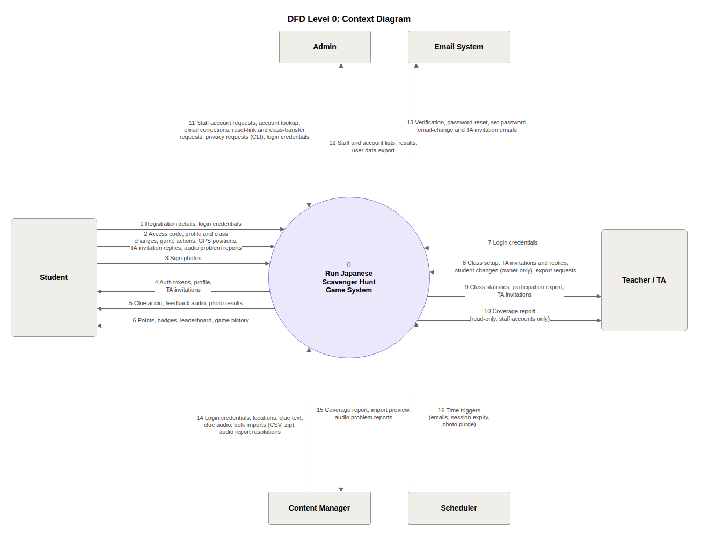
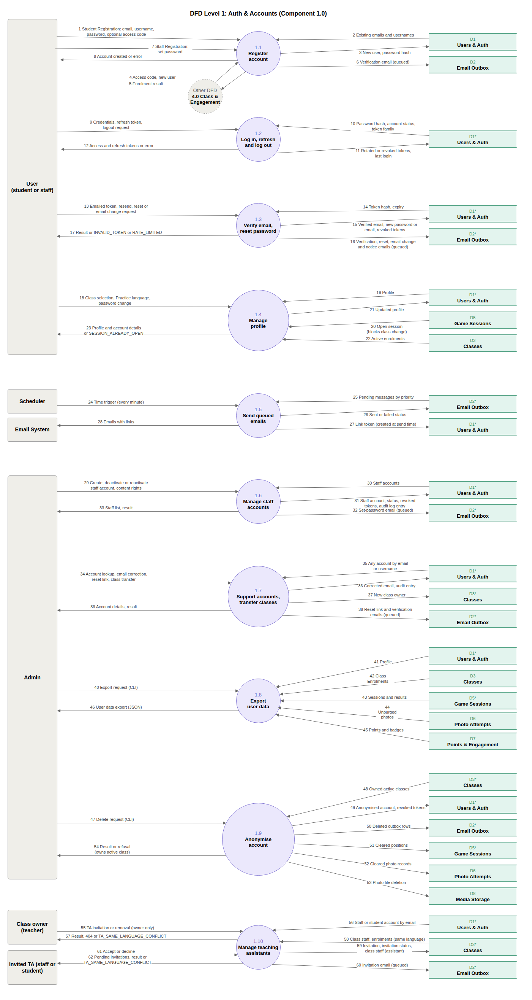
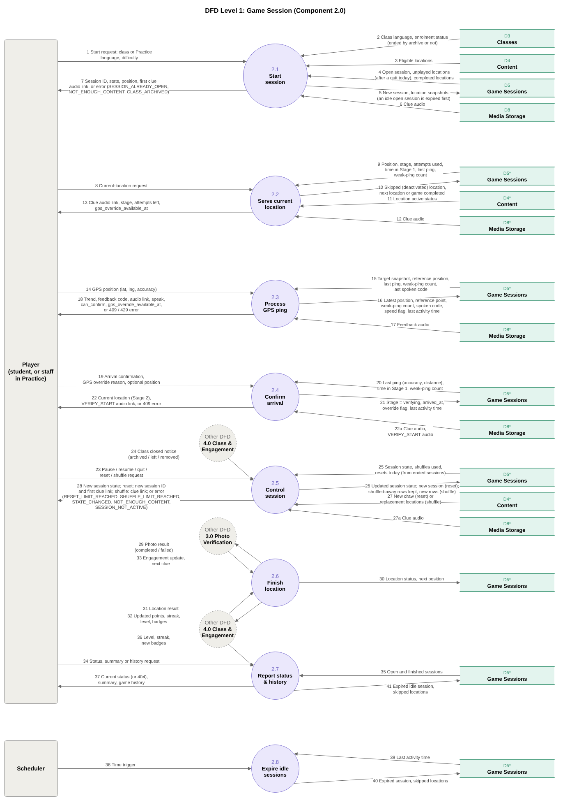
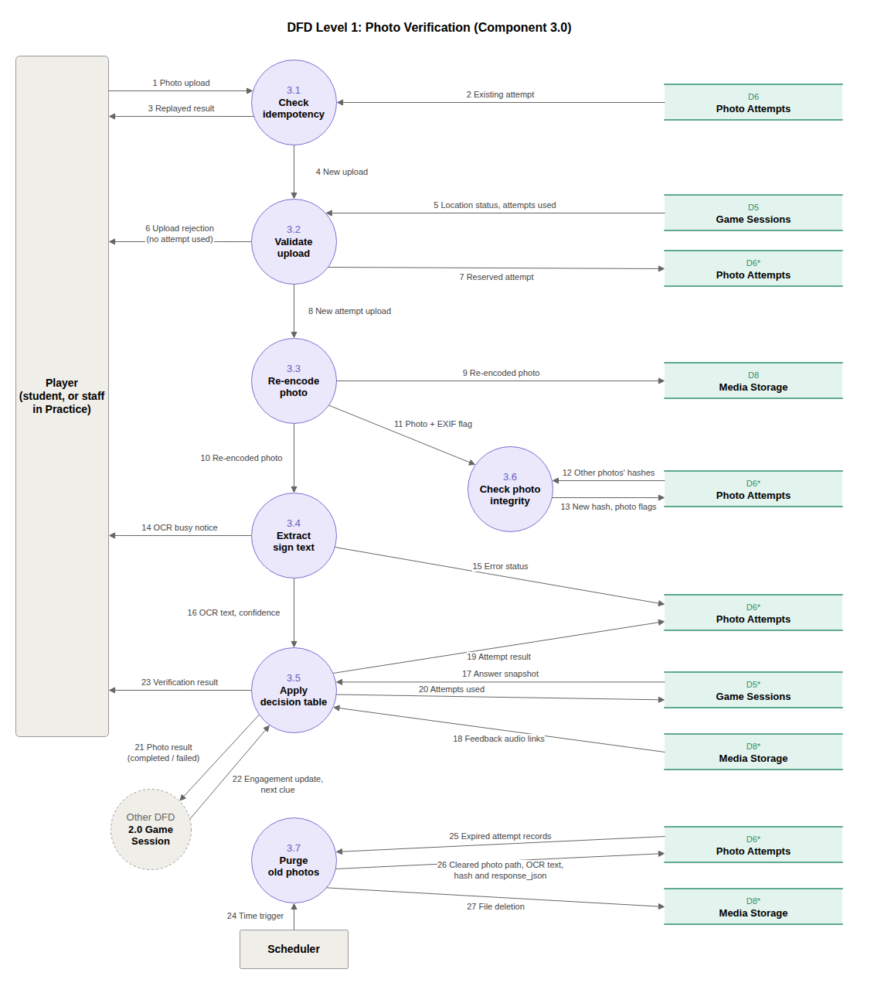
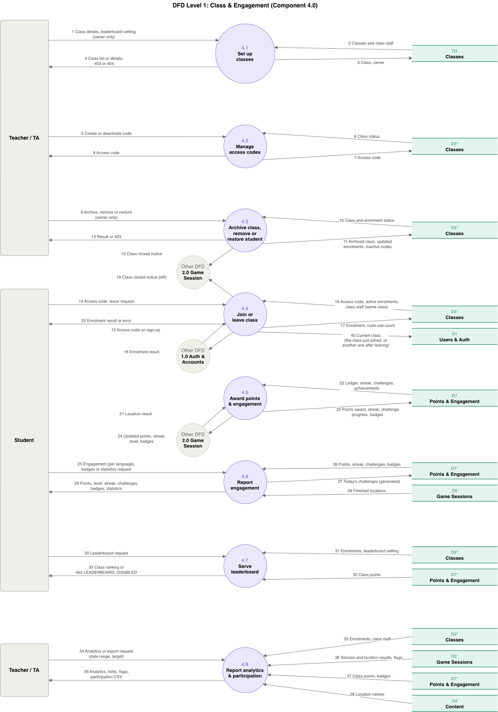
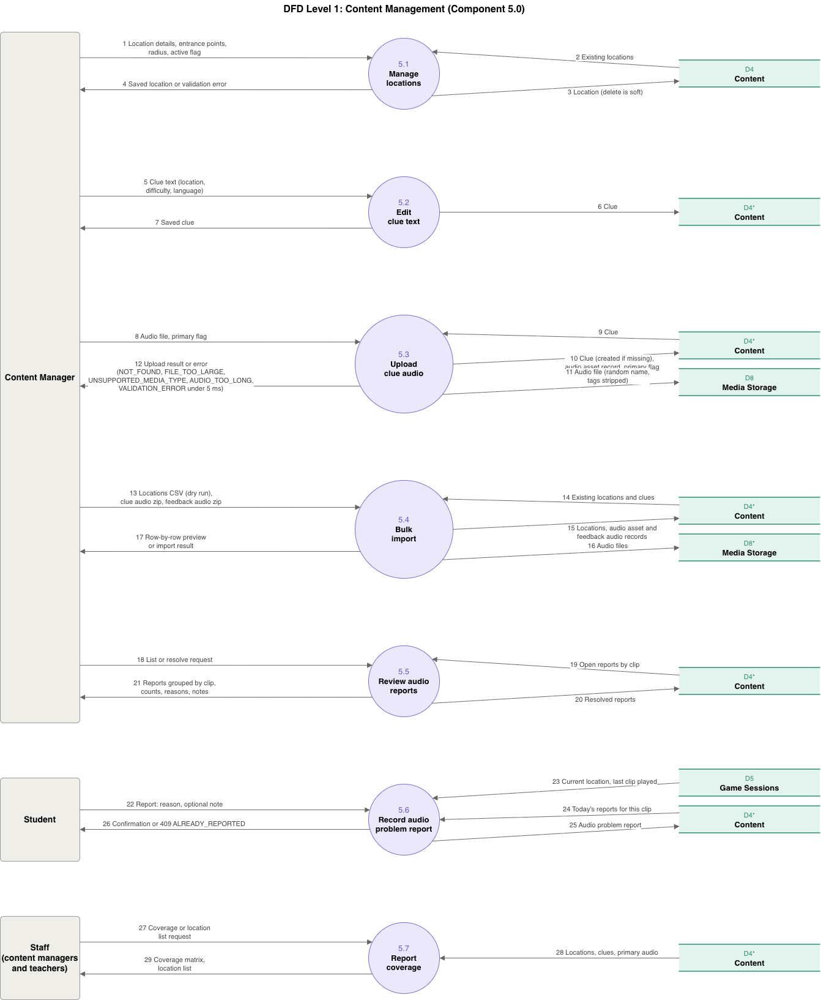

# Week 8 Team Log (Oct. 26 - Nov. 1)

Author: Fabiha Afifa

This week, we focused on finishing the game session lifecycle and on the engagement and content groundwork behind it. The main goals were to let a student pause, resume, quit, reset and shuffle a game, to end idle games automatically, to add the points, levels and achievements that the game will award, and to add the content import and coverage services. We also added login tests and checked concurrent requests so that overlapping requests do not corrupt session data.

The work was distributed so that (PRs merged into main this week are listed first, then PRs that were still open at the end of the week):

- **Mia** worked on game session control.
  - *Merged:* A8: #255, #257, #258, #259; A9: #277, #278, #279, #280, #281, #282, #283, #284. A8 added pause and resume, with the pause and resume endpoints, and the scheduled job that expires idle games. A9 added quitting, resetting and shuffling a game. A reset starts a new game with the same class, language and difficulty, with a limit of three resets per local day. A shuffle replaces the unfinished locations without changing completed locations or earned points, with at most two shuffles per game.
  - *Not merged yet:* A19 (#305-#310), the GPS navigation and arrival confirmation work, which is still in a stack of open PRs.

- **Fabiha** worked on points, levels and achievements (A12).
  - *Merged:* #225, #228, #229, #230. The work added a points ledger, per-language statistics, idempotent location scoring, levels 1-5, and the achievement definitions and the service that unlocks completion badges for 1, 5 and 20 locations.
  - *Not merged yet:* #298, #299 and #300, which add the student endpoints for points, levels and achievements and `score_finalized_location`, the shared function that finalizes a location's score for the game.

- **Eddy** worked on content management (A20).
  - *Merged:* #285, #287, #288, #290, #291. This included the content coverage report service, the locations CSV import service with a size limit, and the clue audio and feedback audio ZIP imports. The imports validate each row or file and report what was accepted and what was rejected.
  - *Not merged yet:* #292, #293, #295 (the location, clue-text, clue audio upload and coverage routes), #296 (the request-body size middleware), and #301, #303, #304 (the fixes for concurrent imports, including deadlocks when two imports process the same content in a different order).

- **Kaedyn** finished the login tests.
  - *Merged:* A2: #266, covering successful login, access and refresh tokens, token rotation, revoked and expired tokens, invalid credentials and disabled accounts.
  - *Not merged yet:* global route rate limiting (slowapi), which is still in review.

Based on the PRs merged into main this week, we met the goal for game sessions and made progress on engagement and content:

- **Accounts:** the login tests are merged (#266), with stronger coverage of authentication and refresh-token behaviour.
- **Game sessions:** A8 and A9 are complete. A student can pause, resume, quit, reset and shuffle a game, and idle games are expired by the five-minute job.
- **Engagement:** the points ledger, per-language totals, levels, and the achievement definitions and badge unlocking are merged.
- **Content:** the coverage report service, the locations CSV import and the two audio ZIP imports are merged.
- **Still open:** the A19 navigation stack, the A12 student endpoints and gameplay scoring function, the A20 routes, request-body middleware and concurrent-import fixes, and global route rate limiting. None of these are on main yet.

The team collectively worked on the following to avoid duplicated logic, inconsistent state and unnecessary dependencies:

- **One session-expiration rule (#257, #259):** the pause endpoint and the scheduled job use the existing session lifecycle logic. `expire_idle_sessions` selects idle games and ends them through `abandon_sessions`, so unfinished locations are skipped and completed locations keep their points. A game can be expired by an ordinary request or by the scheduled job without a second definition of "expired".

- **Safe concurrent expiration (#259):** the job selects open games in id order with `FOR UPDATE SKIP LOCKED`. If another request is already changing a game, the job skips it instead of waiting for its lock. The command processes batches of 500, commits each batch, and stops when a batch is smaller than the limit.

- **Failed actions do not leave a half-done change (#280):** the helper that runs a game action used to commit when the action raised any error. Reset is the first action that writes in several steps, so it now commits only for the idle expiry and rolls back on any other error. A test shows that a reset failing after the old game is abandoned keeps the old game and does not use up a reset.

- **Shared game creation and local-day calculations (#278, #279):** `save_new_game` is the final step of starting a game, and a reset uses it too. `start_of_today` calculates local midnight for daily rules, including the reset limit and the carry-over, so the two cannot disagree about what "today" is. Tests cover local midnight and the night daylight saving ends.

- **Consistent locking for resets (#279):** a reset locks the student before the game, the same order as starting a game. This prevents two resets from both passing the daily limit and avoids a deadlock with a start or a class switch.

- **Preserving game history during shuffles (#281, #283):** shuffled-out session locations are kept, with their photo attempts. A partial unique index lets the replacement locations take the same positions while the old rows stay in the table. The shuffle excludes every location already in that game, and completed locations and points do not change.

- **Stale-request protection for shuffles (#283, #284):** the request includes `shuffles_used`. If it no longer matches the game, the request returns `409 STATE_CHANGED` and changes nothing, so a delayed or repeated request cannot use up another shuffle.

- **Idempotent scoring (#225, #228):** awarded points are recorded in `PointsLedger` with a unique key on student, source type and source reference, so a completed location cannot be scored twice. `UserLanguageStats` keeps a separate total for each language, and the level is calculated from that total instead of being stored.

- **Shared scoring and achievement rules (#228, #230):** the scoring service updates the language totals, and the badge service checks the completion thresholds in the same place, so the game does not need its own copy of the points or achievement rules.

- **Shared content validation (#287, #290, #291):** the locations CSV import reuses the location validation rules, and the audio ZIP imports reuse the existing audio checks and recording services. An import reports rejected rows or files without rejecting every valid entry in the same upload, and a CSV dry run uses a savepoint so the preview does not keep any changes.

The following changes are implemented in PRs that were not merged by the end of the week, so they are listed separately:

- **Shared scoring function (#300):** `score_finalized_location` lets the game finalize a location's score through the engagement interface instead of repeating the points rules. The photo verification step (A10) still needs to call it.

- **Pure navigation rules (#305):** the distance and trend calculations are separated from database operations, using distance bands, a 25-second trend reference, a 10-meter dead band and a 60-second reset window. This lets us test GPS behaviour without waiting for real time to pass.

- **Navigation state and concurrency (#307-#310):** the current-location and navigation endpoints work on the game's current session location. GPS pings are rate-limited, arrival confirmation checks recent position data or an allowed GPS override and is idempotent, and real-Postgres race tests cover overlapping pings, confirmations, shuffles, quits and deactivated locations.

- **Content import concurrency (#301, #304):** two imports can target the same clues or feedback phrases. The import code processes shared content in a consistent lock order and uses an upsert for feedback phrases that may be created at the same time. The concurrency tests use separate PostgreSQL connections and transactions instead of relying only on mocks.

- **Request-body protection (#296):** the proposed ASGI middleware limits request bodies before the application reads an unbounded amount of data and handles requests with and without `Content-Length`. Review found that it still needs tighter per-route limits, so that one small audio upload cannot use the whole ZIP-import allowance.

These changes support the team's architectural goal of keeping business rules inside the component that owns them. Game session transitions stay in game, points and achievements stay in engagement, authentication stays in accounts, and content validation stays in content. Routes call these components through their interfaces and do not repeat their rules.

With everyone's newly merged work for this week, one of the DFDs below is updated and marked **Updated**. The other merged PRs fill in processes and flows that were already drawn.

We considered alternative data flows:

- **Count resets in a new column.** We kept no counter. The daily limit counts the student's games that ended by reset today, using `last_activity_at`, so the count cannot drift from the games themselves.
- **Hide the clue audio in the reset and shuffle response.** The first clue of a reset and the new clue of a shuffle are read from Media Storage like the clue of a new game, so process 2.5 now shows that flow.

### DFD Level 0

### DFD Level 1
**1.0 Auth & Accounts (not changed)**

**2.0 Game Session (Updated)**
- The new flow 27a reads the clue audio from Media Storage (D8) into 2.5 Control session, because a reset returns the first clue of the new game and a shuffle returns the clue of the new current location (#279, #280, #283, #284).
- Flow 25 now reads "Session state, shuffles used, resets today (from ended sessions)", because the reset limit is counted from ended games and not stored.
- Flow 26 now says that a reset saves a new session and a shuffle keeps the shuffled-away rows, and flow 27 says the locations come from a new draw (reset) or a replacement draw (shuffle).
- Flow 28 lists what the player gets back from reset and shuffle, and the errors `RESET_LIMIT_REACHED`, `SHUFFLE_LIMIT_REACHED`, `STATE_CHANGED`, `NOT_ENOUGH_CONTENT` and `SESSION_NOT_ACTIVE`.

**3.0 Photo Verification (not changed)**

**4.0 Class & Engagement (not changed)**

**5.0 Content Management (not changed)**

The main unfinished work at the end of the week is merging the A19 stack, finishing the A20 review and the request-body limits, merging the A12 student endpoints, and connecting scoring to the live photo verification path. Next week, we will divide up the work for the client demo and continue with the later part of the project.
