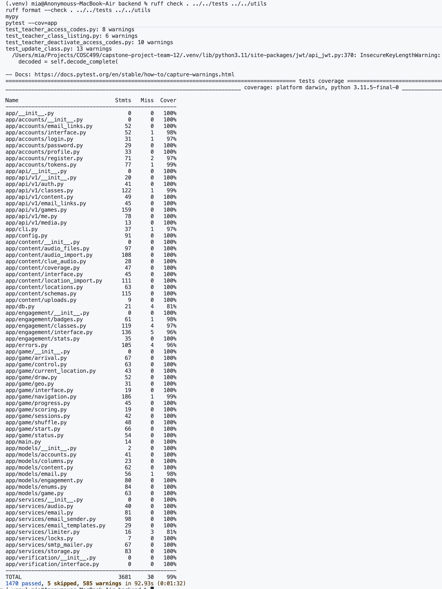
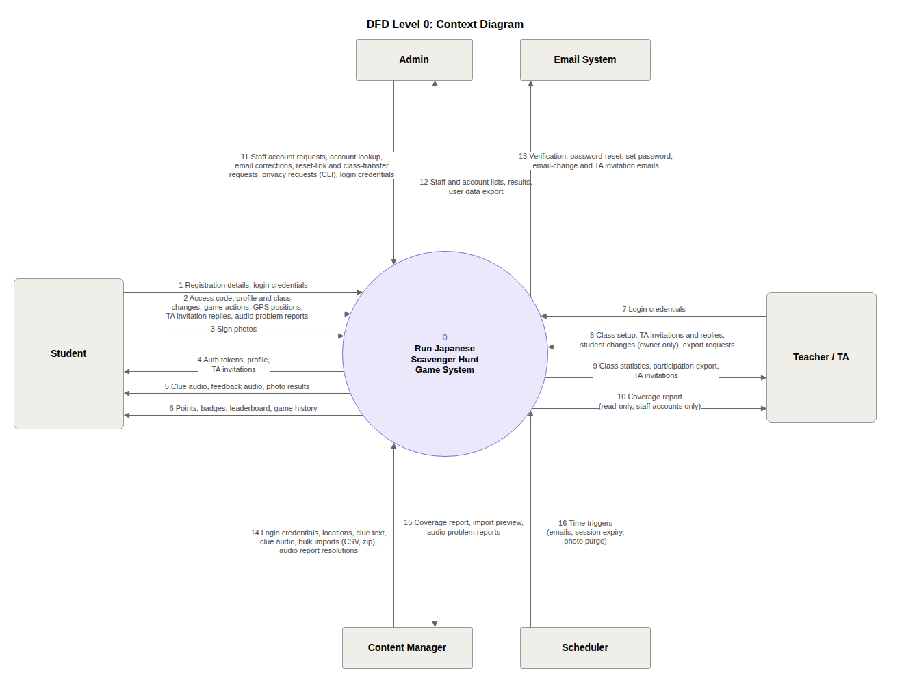
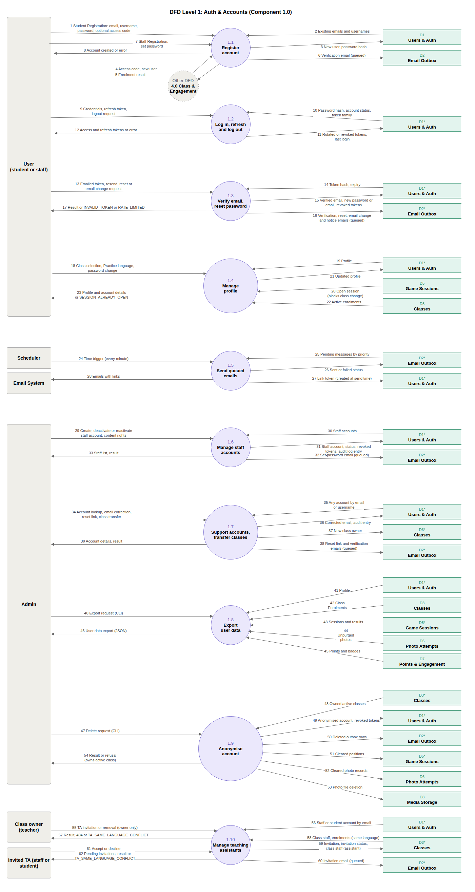
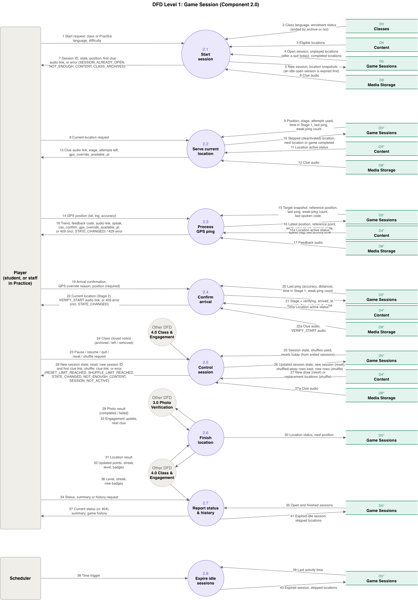
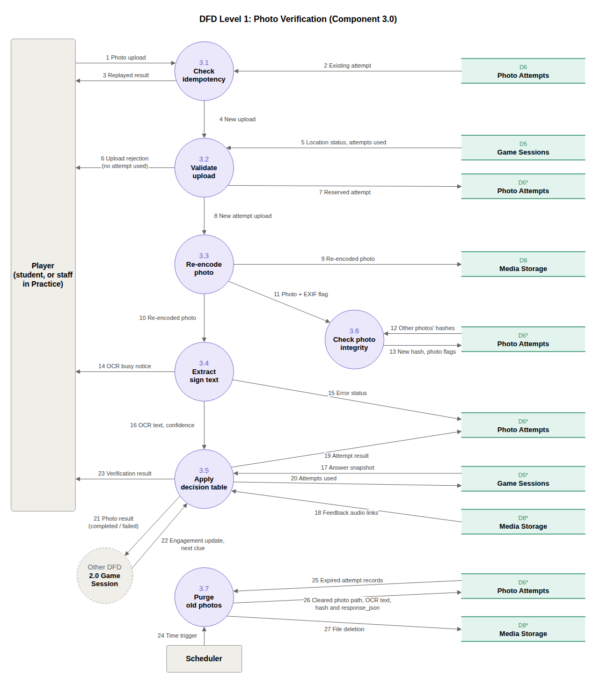
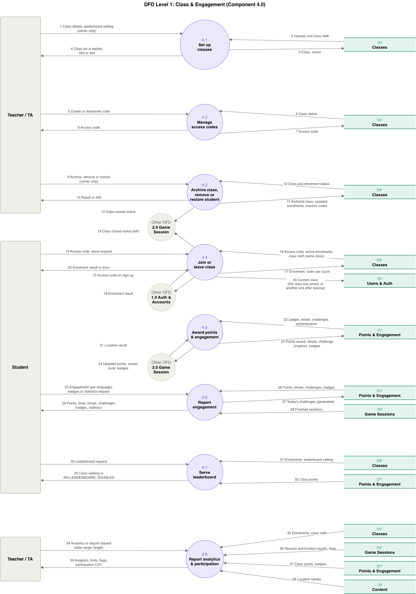
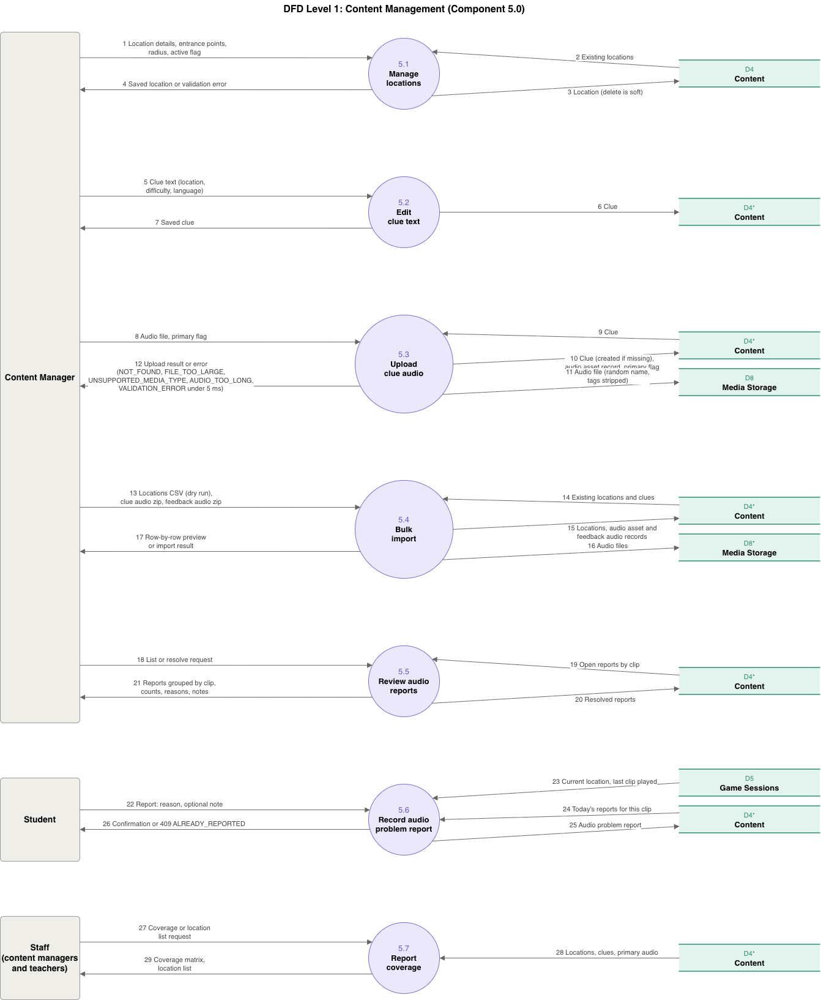

# Week 9 Team Log (Nov. 2 - Nov. 8)

Authors: Mia Kuang

This week, we finished the Stage 1 navigation work (A19), merged the student endpoints for points, levels and achievements (A12) and the first A20 content routes, added the sign-in follow-ups and global rate limiting (A2), and started the account routes for logout, profile and password change. We also discussed the demo for the client on Discord and wrote a first proposal for the student game screens. No frontend code has been written yet.

The work was distributed so that (PRs merged into main this week are listed first, then PRs opened this week that were not merged by the end of the week):

- **Mia** worked on GPS navigation and arrival confirmation (A19) and the GPS replay script (#46).
  - *Merged:* A19 #305-#310 (parts 1-6) and the three follow-up fixes #318, #319, #320. The work added the pure Stage 1 navigation rules, weak GPS and speed-flag handling, `GET /games/{id}/current-location`, `POST /games/{id}/navigation/ping`, `POST /games/{id}/navigation/confirm-arrival`, and Postgres race tests for overlapping pings, confirmations, shuffles, quits and deactivated locations.
  - *Opened this week:* #318, #319, #320 (all merged), and #326, #327.
  - *Not merged yet:* #326 and #327, the GPS replay script for walking routes and the tests that replay routes against the real routes (#46 parts 1 and 2).

- **Fabiha** worked on points, levels and achievements (A12).
  - *Merged:* #298 (student points and level endpoint), #299 (student achievements endpoint) and #300 (`score_finalized_location`, the shared function that finalizes a location's score for the game).
  - *Opened this week:* none. Her A12 PRs were opened earlier and reviewed and merged this week.

- **Eddy** worked on content management (A20).
  - *Merged:* #292, #293, #295, the routes for locations, clue text, and clue audio upload and coverage.
  - *Opened this week:* #321, which refuses a ZIP whose list of files is too long before reading it. It has changes requested.
  - *Not merged yet:* #321, #296 (request-body size middleware), #301 and #303 (the routes for the locations CSV and audio ZIP imports, with the concurrent-import fixes) and #304 (the concurrency tests).

- **Kaedyn** worked on accounts (A2, A22, A24).
  - *Merged:* #286 (sign-in follow-ups) and #314 (rate limiting). #286 added refresh token rotation with a 30-second grace window, so two tabs refreshing together are not signed out, revokes the whole token family when an old token is reused, and runs a dummy password check for unknown emails and over-long passwords so timing does not reveal why a login failed. #314 added the slowapi limiter with a global limit shared by all routes and a login limit per email and IP, a 429 error, and exempts `/health`.
  - *Opened this week:* #323 (user logout, A22), #324 (`GET /me/profile`, A24), #325 (change password) and #328 (rate-limit tests). #323 is `POST /auth/logout`, which revokes all of the user's refresh tokens and deletes the refresh cookie (an access token already issued keeps working until it expires). #324 returns the signed-in user's email, active classes and app settings. #325 is `POST /me/password`: it needs the current password, refuses a new password that breaks the rules or equals the old one, cancels unused reset and set-password links, revokes all refresh tokens and gives this device a new cookie. #328 tests the rate-limit defaults, that the global limit is shared by all routes, and the login limit per email and IP.
  - *Not merged yet:* #323, #324, #325 and #328.

Based on the PRs merged into main this week, we met the main goals for navigation and engagement:

- **Game sessions:** A19 is on main. The game can serve the current location, process a GPS ping, and confirm arrival with a GPS override, and it refuses to confirm a deactivated location.
- **Engagement:** the student endpoints for points, levels and achievements are merged, and the game can finalize a location's score through `score_finalized_location`. The photo verification step (A10) still needs to call it.
- **Content:** the location, clue text and clue audio routes are merged. The upload limits and concurrent-import fixes are still open.
- **Accounts:** the sign-in follow-ups and global rate limiting are merged. Logout, profile and change password are open.
- **Still open:** the A20 request-body limits and concurrent-import fixes, the account routes (#323-#325, #328), and the GPS replay script (#326, #327).

Many PRs were opened but not merged this week. Reviews took longer than we planned: #296, #301 and #321 have changes requested, #303 has comments, #304 is approved, #323–#325 have one approval and need a second, and #326–#328 were opened on Nov 8 and are waiting for review.

The team collectively worked on the following to avoid duplicated logic, inconsistent state and unnecessary dependencies:

- **Navigation rules kept pure (#305):** the distance and trend rules are plain functions with no database access, so GPS behaviour can be tested without waiting for real time. The routes only load the state, call the rules and save the result.
- **One place for progress changes (#306-#309):** moving to the next location and skipping a deactivated location go through the same progress helpers, so the ping and confirm routes do not each have their own copy.
- **Deactivated locations are refused consistently (#320):** ping and confirm both return 409 `STATE_CHANGED` for a location that was deactivated or is not navigating, and position is required on confirm.
- **Safe overlapping requests (#310):** the race tests use separate Postgres connections to check pings, confirmations, shuffles and quits that overlap.
- **One scoring entry point (#300):** `score_finalized_location` lets the game finalize a location's score through the engagement interface instead of repeating the points rules, and it reuses the shared location completion points constant.
- **Shared validation in content routes (#292, #293, #295):** the routes call the existing content services for validation and audio checks and do not repeat those rules.

These changes keep each rule inside the component that owns it: game session transitions in game, points and achievements in engagement, authentication in accounts, and content validation in content.

## Test results

GitHub Actions could not run this week because of the organization's billing, so we ran the CI checks locally on the merged main branch: `ruff check`, `ruff format --check`, `mypy` and `pytest --cov=app`. All of them pass. pytest reports 1470 passed, 5 skipped, and 99% coverage of `app`. We changed our collaboration process so that the CI check is no longer required to merge, and each author posts their local `ruff`, `mypy` and `pytest` results as a comment on the PR before it is merged. The reason we did this is that GitHub Actions jobs could not start because of the organization's billing issue, so no PR could get a CI result. We considered waiting for the billing issue to be fixed, but that would have blocked every merge this week.

## Client demo discussion

This week we discussed the demo for the client on Discord. We have not written any frontend code or opened any frontend PR yet. The discussion produced a first proposal for the student game screens, written from a clickable demo that Mia built. It is a proposal and has not been agreed by the team yet.

- **What the demo shows:** the whole student game flow in one clickable page: Home, Stage 1 (walking to the location), Stage 2 (taking the photo), Result and Summary, and the menu for Shuffle, Reset and Quit. It runs on a phone, and it has a simulator panel for walking speed, weak GPS, being inside the radius and the OCR result of the next photo. The demo page is a design reference only, not code for the app.
- **Main idea:** replace the Stage 1 map, which only shows the student's own dot, with a pixel pet that walks with the student. The pet can be fed and cleaned, hatches and grows as the student walks, and gives them something to look at between locations without hinting where to go. The art is a small pixel grid with a 64x48 grid with a 3-4 colour LCD palette so people who are not artists can draw it.
- **Rules the design keeps:** feedback that carries direction or distance (the `NAV_*` codes) is audio only, and nothing on screen changes with it, including the pet. The pet depends only on how far the student has walked, feeding and cleaning, never on the distance to the target. Weak GPS and the I'm here button can show on screen because they reveal no direction. No room number appears anywhere, including the camera guide.
- **Backend mapping:** each screen maps to endpoints we already have or are building: the game status and shuffles (A8, A9), the current location, ping and confirm-arrival (A19), the photo verification (A10), engagement (A12, A14) and the summary (A23). Two gaps came up: no endpoint returns how many resets are left today, and the override time is server time, so the client should not compare it with its own clock.
- **Spec changes this would need:** replace the Stage 1 map with the pet screen, decide where pet state lives (on the client first, in the backend later), make themes a profile preference (A24), add the two gaps above, and confirm with the client that hand-drawn pixel art counts as designed by the team.
- **Alternative we considered:** keep a map. We did not choose it because a map showing only the student's position carries little information and looks like every other map app. If the team does not want the pet, the fallback idea is five cards where a shuffle redeals a card.
- **Questions for the team and the client:** does the pet carry over between games or start as an egg each time, one theme per language or a student setting, and are feed and clean taps while walking too frequent. These need playtests.
- **Proposed frontend issues:** Eleven issues (F0-F10) for Milestone 2: the spec change, the design system and app shell, the pet sprite engine, the game shell, the Stage 1 and Stage 2 screens, the pet mechanics, the result and summary, Home, the audio problem dialog and permissions onboarding. They have not been opened yet.

## DFD

With everyone's newly merged work for this week, three of the DFDs below are updated and marked **Updated**. The other merged PRs fill in processes and flows that were already drawn.

### DFD Level 0

Not changed.

### DFD Level 1

**1.0 Auth & Accounts (not changed)**

**2.0 Game Session (Updated)**

- Flow 19 (Student → 2.4 Confirm arrival): "optional position" changed to "position (required)". confirm-arrival now needs the position the app is confirming.
- Flow 18 (2.3 → Student): the error list now reads "409 (incl. STATE_CHANGED) / 429 error". A ping on a location that was deactivated returns 409 `STATE_CHANGED` and writes nothing.
- Flow 22 (2.4 → Student): the error now reads "409 error (incl. STATE_CHANGED)". Confirming a deactivated location, or a stale position, returns 409 `STATE_CHANGED` and writes nothing.
- New flow 15a "Location active status": D4* Content → 2.3 Process GPS ping.
- New flow 20a "Location active status": D4* Content → 2.4 Confirm arrival.
- Layout: two new D4* Content stores, one in the 2.3 row and one in the 2.4 row. The D8* Media Storage store in the 2.4 row moved down to make room. These changes follow #320.

**3.0 Photo Verification (not changed)**

**4.0 Class & Engagement (Updated)**

Flow 25 (Student → 4.6 Report engagement) now reads "Engagement (per language), badges or statistics request". `GET /me/engagement` returns points and level for one target language (#298).

**5.0 Content Management (Updated)**

Flow 12 (5.3 Upload clue audio → Staff) now includes "VALIDATION_ERROR under 5 ms" in the upload errors. A recording shorter than 5 ms is refused with 422 (#295).

Next week, we will get the open PRs reviewed and merged (A20, #323–#325, #328, #326 and #327), connect scoring to photo verification (A10), and decide with the team whether to go with the pet or the card design before opening F0.
